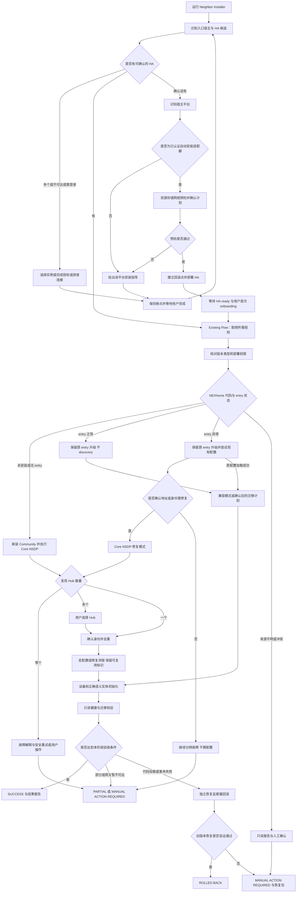
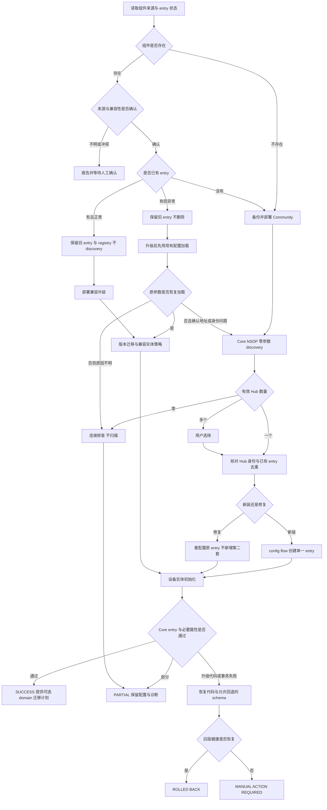
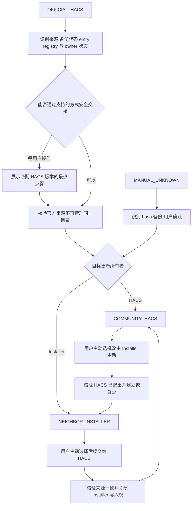

# NEXhome Neighbor Edition 总体架构

Status: **Architecture / Prototype Planning**。本文为未来实现的架构提案，不是已发布产品的安装说明。

本文为持续维护的架构提案。当前项目处于 Architecture / Prototype Planning，仅整理文档与既有验证结论；正式 Installer、Community release 尚未发布。文中的组件、接口契约和阶段名称均为拟议设计，不代表已经开发或验收。

**核心建议：一个统一入口，分离平台适配、NEXhome 核心集成、户型设置三层；先保证已有用户可回滚升级，再提供新用户免输入 Hub 参数的接入。** “零参数”指不要求填写 NEXhome IP/SN，不等于跳过 HA 管理员授权、宿主权限、首次账号创建或房间归属确认。

## 1. 项目目标与自动化边界

面向同小区、设备组合相近但家庭命名和房间偏好不同的住户。目标体验是“运行入口—识别现状—展示变更摘要—授权后自动完成可安全部分—给出明确结果”。不要求用户理解协议、逐个包装开关或手工拼装安装命令。

最高原则是本地、透明、用户自己掌握控制权：不建立第三方远程控制通道，不默认上传家庭状态，不要求向维护者提交密码、token 或 SN；每次安装和升级让用户知道用途、变更与恢复方式。不得让邻居产生被项目方监视、控制或收集家庭数据的误解。

同时守住：已有配置不丢、用户实体和自动化不被粗暴替换、失败有独立恢复路径、重复运行不产生第二套设备、无位置窗帘不伪造状态。

| 可尽量自动 | 必须有明确边界 |
|---|---|
| 识别支持平台、读取安装状态、下载已校验发行包、备份、部署、健康检查 | 没有宿主权限不能写组件；没有管理员授权不能操作 HA |
| 新装时由 Core 广播取得 Hub IP/SN | 多 Hub、不同网卡候选或身份冲突不得自动猜 |
| 已有正常 entry 原地升级与同域标识保持 | 跨 domain 的 entity_id 无法完全保持，不能承诺无损透明迁移 |
| 基于协议能力生成正式 light/fan/climate/cover | 不用中文设备名决定 domain 或 Area |
| 导出脱敏诊断、列出户型建议 | 不静默改 Area、房间、Dashboard 或个人自动化 |

未知或不可达的 HA 必须先区分“未找到”“需要登录”“地址不可达”“发现多个实例”。**不能把一次连接失败解释成家里没有 HA，然后自动新建第二套。**

## 2. 已验证基础能力与证据等级

| 能力 | 当前证据 | 不应扩大为 |
|---|---|---|
| NSDP 回包 LOCATION 与 MODEL.sn | 已知 IP 单播、未知 IP 的 LAN 广播均成功；MODEL.sn 与正式 sn_input exact match | 所有型号、所有网络都支持 |
| Core 内零参数发现 | 2026-10-20，Core 主进程/主线程创建、发送、接收；一次 UDP1912 广播成功 | 安装器/config_flow 已实现 |
| HTTP 与共享协调器 | 已实施 connect/read timeout、共享分片读取、队列、串行控制、失败语义、pending 与真实读回 | 任意规模/网关均有性能保证 |
| 灯光 | 代表样本开关、外部变化收敛和短时稳定观察通过 | 新的原生 light/fan domain 迁移已验收 |
| type 3 空调 | numeric 0 关机、设温/模式/风速、缺可选室温可用，代表样本已现场验收 | type 73/100/101/102/107 同样经过现场验收 |
| type 11 地暖 | 缺可选室温不再拖累可用性 | 地暖控制已现场验收；type 35 已现场验证 |
| type 6 窗帘 | 有 Location 的开关、约 50% 定位、外部位置回传；无 Location 的开关实际验收 | 无位置型号可知道真实开合；Stop 中途效果已验收 |
| UDP 状态快通道 | 已有解析/合并定向刷新实现，轮询兜底存在 | 本次 discovery 成功等于状态 push 交付率已验证 |
| 运行稳定性 | 多轮约 15 分钟观察无线程/连接持续增长；部分故障恢复有现场/离线证据 | 已有 24 小时或长期多户稳定性证明 |

type 30/108 cover、其他 climate、风扇等未完成同等级现场验证者，必须标 `untested` 或 `offline-tested`；不能在界面或发行说明里汇总成“全部设备支持已验收”。无位置 type 6 的 Open/Close/Stop 固定值只是核心回包依据，不证明电机在线或动作完成。

技术能力来自有限真实 NEXhome + Home Assistant 环境的验证；本仓库只保留脱敏结论，不包含原始家庭测试记录。

## 3. 核心 Community integration 边界

建议对用户称为 **NEXhome Community integration**，Neighbor Edition 是整套安装/设置体验的名称。为现有升级保留集成 domain `nexhome`，不为产品改名另造 `nexhome_neighbor` 并创建第二套 entry。

### 3.1 核心应负责的模块

| 模块 | 职责与不变量 |
|---|---|
| Transport / GatewaySession | 每次 HTTP 都有 connect/read timeout；检查 HTTP/JSON/业务结果；关闭资源；统一可识别异常。协程外层超时不能替代阻塞 requests 自身超时 |
| GatewayScheduler | 一个 Hub 共享有限队列和总并发预算；轮询分片串行；控制优先但有连续控制额度/轮询最迟服务期限；同设备命令顺序明确 |
| Coordinator / StateStore | 合并读取、按属性有效值更新时间；失败抛正确 UpdateFailed；可发布有效子集但不伪装全成功；网络恢复后自动恢复 |
| Command pipeline | 明确开关必须发明确命令；检查接受结果；pending 有期限；命令后真实定向读取；失败清理；不盲重发；拒绝命令前旧查询覆盖 |
| Capability adapters | 按 type、协议声明与实际有效属性决定 domain/能力；必需/可选属性分开；未知类型不乱发命令 |
| Discovery | Core 内有限次 NSDP 广播、解析/去重、Hub 身份与 endpoint；独立于配置读取，不扫描 |
| Push receiver | UDP1912 状态事件只作为快速刷新线索；坏包容错、按设备合并，不清掉所有 pending；轮询始终兜底 |
| Config / Repairs / Diagnostics | 正常配置、修复、兼容迁移、同 Hub 去重、脱敏状态与故障原因 |

当前 `(3,8)` 秒、64 属性分片、约 3 秒轮询、15 秒新鲜度等是既有测试环境现有实现参数，不直接变成所有邻居的性能承诺。发行默认值应经多户负载测试再冻结；调参只暴露少量有界选项，不能取消 timeout/队列边界。

“可用”要按设备类型的必需字段判断；协调器部分更新失败、个别可选字段缺失和整个实体 unavailable 是三种不同信息。不能用一个全局成功布尔值覆盖它们。

### 3.2 domain 与设备语义

新装直接创建语义正确的正式实体：灯为 light、排风/风扇为 fan、空调及地暖为 climate、窗帘为 cover，真正的通断负载才保留 switch。传感器独立为 sensor/binary_sensor 等有依据的平台。

映射键应是协议 type + capability/型号证据；设备名称只用于展示。type 1 的普通开关灯可映射为仅开关能力的 light，不凭空提供亮度。风扇没有档位证据时仅提供实际支持的开关，不虚构 percentage。

空调与地暖虽同属 climate，核心应保留设备类别/能力标记供上层区分。Profile/Dashboard 必须显示成“空调”和“地暖”，不能混为一个区域。

已验证的 type 3 关机数值 0 必须限定在已确认协议范围，不能全局把所有设备关机格式改为数值 0。climate 室温等可选字段缺失返回 None；必要字段读失败/过期仍不可用。

type 6 cover 有可靠 Location 证据时提供位置；没有定位能力时只提供 open/close/stop、位置与闭合 unknown。不要从固定 1 字段、最后一次按钮或估算行程伪造状态。能力注册应区分“从未支持”与“支持但暂时读不到”，短暂缺包不能永久裁掉硬件能力；其策略需专门测试，不假装当前补丁已经完成新能力模型。

### 3.3 明确不进入核心

Area、户型房间、Light/Cover Group、总控、Dashboard、用户重命名、个人自动化，全部留在 Neighbor Setup/Profile 层。核心不得静默重排现有用户环境。

## 4. Installer 分层架构与权限

```text
统一入口 / 中文向导
  -> 环境和权限检测器
  -> 只读盘点与变更计划
  -> 安装事务协调器 + 独立恢复监督器
       -> HA 之前：Linux Docker / DSM / PVE / 条件软路由适配器
       -> HA 之后：组件部署适配器 + 经授权的 HA 控制通道
  -> HA Core 中的 Community integration
  -> 可选 Neighbor Setup / Neighborhood Profile
  -> 本地结果单与脱敏 Diagnostics
```

| 层 | 输入/输出契约（概念设计） |
|---|---|
| Detector | 返回实例候选、安装类型、版本、路径/namespace 身份、可用权限；不读密码库或猜登录 |
| Planner | 产生变更清单、影响、最低权限、停机点、备份点、回滚范围和需要确认的项目 |
| Platform adapter | 只操作已选宿主及本次创建/接管对象；提供 preflight、prepare、backup、activate、health、rollback、resume |
| HA channel | 管理员授权后的状态、配置流程、修复和集成健康；不是通用文件管理/宿主 shell |
| Release catalog | 版本、文件清单、hash/签名、兼容区间、配置 schema 与迁移/回滚策略、验收矩阵 |
| Journal / watchdog | 安装 UUID、阶段、文件指纹、对象所有权、恢复进度；存在 Core 之外，Core 起不来时仍能恢复 |

**必须分开两种权限：** HA 管理员 API 授权与宿主/配置卷部署权限。普通 HA REST token 不能被当成任意 `/config` 写文件、安装 custom component 或运行宿主命令的授权。公开 REST 文档描述的能力不能扩展成未存在的安装 API。[HA REST API](https://contributors.home-assistant.io/core/internals/rest-api/)

已有 HAOS 可通过用户授权的配置目录部署入口或 HACS 完成文件部署；未来 HAOS bootstrap 适配器须单独开发/测试，不假定 Terminal 的网络 namespace 就是 Core。Container 用已确认的宿主 bind mount；PVE 负责 VM 生命周期，不能把 PVE 文件系统当成 VM 的 `/config`。

HAOS 受限入口若尚未授权，向导给出一次最小引导并保存断点，不伪称“发现 HA 就能远程自动安装”。不自动开放 SSH、挂载 Docker socket、改路由或关闭安全校验。也不把自更新权限塞进核心 integration；组件更新由安装/更新层完成。

公开 HA 的发现优先 mDNS/已知实例地址和用户指定地址；多实例要求选择。不做全网地址/端口穷举。所有写入以用户确认过的目标实例和事务计划为边界。

## 5. HA 环境支持矩阵

官方当前支持类型为 HAOS 与 HA Container；后者没有 HAOS 的 Supervisor/apps 能力，不能共用假定所有安装都具有附加组件的脚本。[安装类型](https://contributors.home-assistant.io/os/installation-types/)、[Linux 安装说明](https://www.home-assistant.io/installation/linux/)

下表为**拟议产品支持次序**，不是现有已测试平台清单。

| 用户环境 | HA 之前 | HA 已有之后 | 首发策略 |
|---|---|---|---|
| 已有 HAOS | 不另装 HA | 授权配置目录/HACS 部署通道 + HA API；Core 内统一流程 | 第一优先，限已实现并通过恢复测试的部署入口 |
| 已有 HA Container | 不另装 HA | 核对真实 `/config` bind mount、容器/实例身份及宿主权限 | 第一优先 |
| Debian/Ubuntu + 已有 Docker Engine | 新建独立持久配置目录、Container 与独立 journal | 同一统一流程 | 首个新建 HA 适配器；先支持窄版本/架构组合 |
| 普通 Linux 尚无 Docker | 先确认依赖安装与宿主权限 | HA ready 后相同 | 首版引导装好 Docker，不自动改造所有发行版 |
| Synology DSM / Container Manager | 检查机型、DSM/架构、卷、权限和 LAN 网络方案 | Core 内流程相同，部署适配器不同 | 第二阶段单独认证，不泛化为所有 NAS |
| PVE | 建议官方 HAOS 镜像 + 桥接 VM；明确存储、VMID、资源预算 | VM 内部署与 HA 控制独立 | 第二阶段；不接管/重建已有 VM |
| iStoreOS/OpenWrt 等软路由 Docker | 先通过专用存储/网络/资源门槛 | 已有 HA 仍先核对网络与更新权限 | 条件支持、默认不自动安装 |
| QNAP/Unraid/TrueNAS | 对应安装指导 | 已有可用 HA 可评估统一后流程 | 不首发自动新建；不宣称平台已认证 |
| Windows Docker/Desktop | 不用于首发自动部署 | Windows 可做入口客户端，操作远端已授权 HA | 新建 HA 给 HAOS/受支持宿主指导 |
| 没有可用宿主 | 设备/HAOS 选择向导 | 装好 HA 后续接 | 不能软件自动创造硬件 |
| 旧 venv/Core/Supervised 等历史安装 | 不在原地自动升级宿主 | 识别版本/风险并给迁移指导；不默认替换 | 不承诺首发自动支持 |

Linux Container 倾向 host 网络以便 LAN discovery；官方安装说明也采用 host 模式。具体需核对 Docker Engine、架构、存储和 HA 支持区间；不把端口映射等同于广播可达。仅映射 8123 不解决 UDP discovery。[Linux Container 安装](https://www.home-assistant.io/installation/linux/)

## 6. 完整决策树

### A. 用户统一总流程



图中的“确认计划”可在本次向导开始时覆盖明确的自动备份/部署/重启，不逐步弹出重复确认；变更 Area、选择多个 Hub、未知本地改版、破坏性宿主变更不能从笼统授权中推断。

## 7. 已有 NEXhome 升级流程

### 正常 entry：保留配置是默认路径

1. 只读盘点：代码来源、manifest + 文件树 hash、HACS 所有权、entry 数量/状态、原始字段名、设备/实体 registry 标识及用户隐藏/禁用标志。
2. 区分已知官方基线、已知 Community 版本、已知本地补丁、未知改版。**manifest 仍写 1.1.16 不能证明文件没改过**；保留原版本号的本地补丁就是反例。
3. 未知 hash、重复 domain 安装、多个冲突 entry 或不兼容 schema：只生成比对/迁移报告，暂停覆盖；不静默扔掉本地补丁。
4. 通过来源与兼容预检后，生成备份与迁移计划。运行正常者**不重新 discovery、不创建新 entry**；保留现有 entry_id、数据键和值、筛选设置与选项。
5. 部署固定发行版；按该版本要求重启 Core。更新 Python 文件时不能假定一次 entry reload 一定加载新模块；按实际版本验收确定重启策略。
6. 旧用户默认先走兼容实体模式，保留原 unique_id/device identifiers/实体入口。能力升级或 domain 迁移放在独立、可撤销阶段。
7. 检查 entry loaded、必要属性新鲜、实体未成批重复、队列/错误未失控；不主动开关灯具/空调验证。
8. 发布事务结果、保留回滚点。后续运行发现版本/hash/阶段已满足则 no-op。

### 异常 entry：升级与修复分开

先保存旧 entry，部署兼容版本，再用现有参数尝试加载。`setup_retry`、个别实体 unavailable、缺可选属性并不意味着 SN 错了；不能一失败就重建。

如果有证据支持旧 endpoint 不再可用、Hub 地址变化或身份参数不适配，才进入用户可见的“修复连接”流程，运行 NSDP，并将发现身份与既有 identity 比较。同 Hub 的新地址可以提议更新 endpoint；SN 不同可能是另一台 Hub，须解释差异并由用户确认，不能把其全部设备 graft 到原 entry。

修改 entry 走 HA 的配置/重配置能力及版本化迁移 API，不直接编辑 `.storage`，不直接赋值篡改 `unique_id`。HA 对此有明确约束。[配置流程](https://contributors.home-assistant.io/core/integrations/config-flow/)、[ConfigEntry 更新要求](https://developers.home-assistant.io/blog/2024/02/12/async_update_entry/)

禁用 entry 是用户意图，自动流程不擅自启用；报告为“已存在但被禁用”。加载状态与实体级健康分开显示。

## 8. 新安装流程与三类用户体验

### 新装统一后流程

未安装组件：校验发行包 → 备份冲突路径/确认无同域组件 → 部署 Community → 必要重启 → Core config flow 运行 NSDP → 用户确认发现的设备/去重 → 创建一个 entry → 首次设备初始化 → 只读验收。

已安装无 entry：先判断版本/来源；已为目标版本则不重装；旧版可安全升级才部署。其后才进入同一发现/配置流程。

“自动创建 entry”由 integration 自身 config flow 完成，Installer 只驱动经授权、已验证的配置流程；不通过写入 config_entries JSON 合成记录。唯一 Hub 可在用户已经点击“添加 NEXhome”的授权范围内完成，界面不再要求手输 IP/SN；仍显示确认结果。多个 Hub 一定人工选择。[HA config flow](https://contributors.home-assistant.io/core/integrations/config-flow/)

### 三类小白用户看到的体验

| 用户 | 界面流程 | 不可省掉的最小交互 |
|---|---|---|
| 已有 HA + NEXhome | 找到你的 HA → 将备份并升级，保留现有配置 → 完成/已恢复旧版 | 首次管理员/部署授权；未知本地版时确认；domain 迁移可暂不做 |
| 已有 HA，无 NEXhome | 找到 HA → 安装组件 → 正在找中控 → 找到一台 → 设备就绪 | 首次授权；多个 Hub 选择；无需填写 SN |
| 什么都没有 | 识别宿主 → 支持则准备 HA，不支持给该平台指导 → HA ready → 同一 NEXhome 流程 | 宿主写入授权、首次 HA owner/onboarding、资源/存储选择；无硬件者先准备设备 |

HA onboarding 的 owner 账号、认证与家庭设置走官方交互，不创建通用默认管理员、不替用户保存密码、不静默设置精确家庭位置。重跑入口能接着上一阶段，不要求小白从头做一遍。

## 9. Config entry 状态机与子流程

Installer 的事务状态与 HA 原生 entry state 是两套状态；不能把 `ROLLED BACK` 写进 HA entry 或把 `unavailable` 当作 entry state。

| 识别状态 | 动作 | 下一步/终止 |
|---|---|---|
| A：组件不存在 | 安全部署后开始 flow | DISCOVERING |
| B：组件存在，entry 不存在 | 判断来源/是否需升级 | DISCOVERING |
| C：entry loaded 且基本健康 | 原 entry 原地升级，不 discovery | VERIFYING |
| D：entry setup_retry/setup_error 等 | 保留 entry；兼容升级；先尝试原参数 | VERIFYING 或 REPAIR_REQUIRED |
| loaded 但部分实体 unavailable | 分必需/可选字段、设备故障、读取错误 | PARTIAL；不重建 entry |
| migration_error/版本不兼容 | 停止 schema 继续升级；按兼容规则回滚 | ROLLED BACK 或 MANUAL ACTION REQUIRED |
| 用户禁用/正在 unload/setup | 尊重禁用；在途状态等待有界时间 | 明确等待/人工操作，不重复启动 flow |
| 多 entry/同 Hub 身份冲突 | 只读列出冲突 | 用户选择/人工处理，不去重删除 |

拟议事务阶段：`DETECTED → AUTHORIZED → PLANNED → BACKED_UP → STAGED → ACTIVATED → VERIFYING → COMMITTED`；失败进入 `ROLLING_BACK → ROLLED_BACK` 或 `MANUAL_ACTION_REQUIRED`。每一步有前置指纹、可重入检查和恢复动作；凭据不进 journal。

### B. Integration / config entry 子流程



配置 schema 首版应兼容当前实际 `sn_input`、`ip_address` 和已有选项；“SN 本质是 sn”不构成立刻重命名数据键的理由。将来需要新 schema 时采用明确 VERSION/MINOR_VERSION 迁移与向后兼容期，不能边发布边猜旧版字段。

## 10. switch → light / fan 实体迁移策略

**跨 domain 不是普通改名。** `switch.xxx` 与 `light.xxx`/`fan.xxx` 是不同 HA 实体入口，服务、能力、自动化条件和历史语义不同；保留 basename 不等于保留完整 entity_id。HA registry 以实体身份保存用户设置，必须使用其受支持能力，不能靠改 JSON 或假设换 unique_id 能无损变 domain。[Entity registry](https://contributors.home-assistant.io/core/entities/registry/)

### 10.1 新旧用户使用不同默认

- **新装：** 根据明确 type/capability 创建原生正确 domain，不再让用户手工建大批 wrappers。每个物理功能有稳定身份，不为未知负载自作分类。
- **旧装升级：** 默认兼容模式，原 entity_id/unique_id/设备关系继续存在且可控制；先交付可靠性修复，再展示可选“整理为灯光/风扇”的迁移向导。不能把跨域迁移强塞进无人值守升级。
- **完成选择后：** 创建新的正确 domain 实体，尽量保留 basename、device relationship 与用户认可的 Area；保留旧 switch 记录作为可恢复兼容入口。旧入口若仍被自动化引用，不能立刻禁用；隐藏不等于禁用。

兼容旧 switch 应由**同一集成、同一设备控制器/锁/协调器**委托执行，不能新增另一份独立轮询和并发命令。新用户不默认创建这些兼容实体。

### 10.2 迁移前盘点

生成 `旧实体 → 新实体 → 物理功能 → registry identity → 引用清单 → 可逆动作` 计划，读取可获取的 automation/script/scene、Dashboard、helpers、现有 wrappers/groups 与设备自动化引用。动态模板、外部系统、Node-RED/AppDaemon 和代码拼接引用可能无法穷尽，报告必须标“未知引用”，不能称检测完全部依赖。

部分已有用户已创建正式 light wrappers、Light Groups 和模板总控：优先识别它们，不能给同一灯再造一个同名原生 light、自动产生 `_2` 后视为完成。选项应是“暂保留原展示链路”或“逐项替换并核验”；房间 group 与叶子 light 必须分清，禁止把总控误认成设备实体。

### 10.3 分批迁移与回退

| 阶段 | 默认行为 | 回退边界 |
|---|---|---|
| M0 盘点 | 只读、生成冲突和引用报告 | 无改动 |
| M1 兼容升级 | 旧入口继续工作；原生映射可以先在计划中预览，不自动双份展示 | 恢复组件版本，entry schema 必须可读 |
| M2 用户确认一批 | 创建/启用正确 domain，保留设备关联；引用替换只覆盖用户确认的对象 | 保存每项前值，检查未被用户另改后逆向撤销 |
| M3 观察 | 原入口可隐藏但仍启用以保留自动化；不制造“两个独立设备” | 一键恢复原展示与引用 |
| M4 用户确认清理 | 有证据且用户同意才禁用旧入口；不默认删除 registry | 重新启用旧入口并恢复引用 |

entity_id 冲突先提示或给可预览的新名称，不静默挤占用户实体。用户已经设置的隐藏/禁用/Area 优先级高于安装默认。迁移报告记录成功、保留、跳过、冲突、未知引用和回滚点；Recorder 历史连续性不保证跨 domain 无损合并，也不自动改数据库。

**首版建议只实现 M0/M1 与新装原生域，M2–M4 后续做向导。** 因此旧用户第一版可能仍看到已有 switch，这是明确的兼容选择，不是假称实体语义已经完全迁完。

## 11. NSDP 零参数 discovery 正式设计

能力已经实测成立；正式实现仍需产品化：

1. 用户启动首次配置或明确修复流程，Core 读取自己可用的 LAN adapters。
2. 选择合理广播接口；多 LAN 不把第一个网卡当成正确答案。可按系统首选 LAN 提议，歧义时让用户选择网络，不要求输入 Hub IP。
3. 自动计算 broadcast，Core 自己创建 UDP socket，允许 broadcast，绑定选定地址与临时接收端口；NSDP HOST 填自身接收地址，不填已知 SN 搜索条件。
4. 有界发送 1–3 次、每次约 2–5 秒；解析 response、LOCATION 和 MODEL.sn。复用有限发现窗口，同一个流程不对每个实体重复广播。
5. 严格校验报文大小/编码/重复字段/响应格式及 URL。LOCATION 只接受预期局域网 HTTP endpoint，不接受凭据 URL、file URL、任意公网/loopback 跳转；SN 只做协议解码，不偷偷 trim/改大小写来合并身份。
6. 同一 SN 不同接口响应可聚合为一个身份、保留 endpoint 候选；不同 SN 的多个 Hub 必须用户选择。同一 SN 出现冲突信息先停下来，不能“先到先得”。
7. 用稳定 Hub 身份作新 entry 去重键；SN 不进日志/UI 明文。不以 IP 作为永久唯一身份。已有 entry 没有 config-flow unique_id 时，先按受支持的兼容流程核对，不能另建一套。
8. 在创建/修复 entry 前做受控、只读的连接/协议兼容校验；这属于未来产品流程，不代表当前文档规划阶段或此前 discovery 测试调用过业务接口。绝不以设备控制验证身份。
9. 结束即关闭当前文档规划阶段 socket；如与状态 push 共用 1912 监听，设计明确的单一 dispatcher 与生命周期，避免两个服务抢占端口。

| 结果 | 用户体验 | 后续 |
|---|---|---|
| 0 Hub | “未找到中控；请确认同一局域网、网络隔离/防火墙与中控供电” | 保留诊断、有界人工重试；不自动扫描/单播猜地址；可选高级手工配置作为单独入口 |
| 1 Hub | “找到一台中控”，显示脱敏身份和基本信息 | 用户已授权本次添加时自动继续/一次确认；不再填 IP/SN |
| 多 Hub | “找到多台中控，请选择” | 明确候选，不自动猜；第一版可仅支持为本次选择的一台配置 |
| 已配置同 Hub | “已经配置” | 返回现有 entry；健康则不触发重建；修复模式才提议新 endpoint |

NSDP 是 UDP1912 自定义协议，不等于 HA manifest 的标准 SSDP 自动发现。首版用 `user` 首次 config flow 显式触发有界 discovery 即可，不虚构 HA 已有 NSDP matcher；将来后台发现入口需单独设计。HA 的 config flow 提供身份去重与重配置模式可作为承载。[配置流程与 unique ID](https://contributors.home-assistant.io/core/integrations/config-flow/)

未知包、伪造包和同 LAN 恶意回应仍可能存在；发现不构成设备真实性的密码学证明。不得依回包执行 shell、下载程序或把 HTTP endpoint 当任意代理。

## 12. 软路由存储 / 网络预检

**有 Docker 不是通过条件。** 软路由承担主网络服务，专用适配器默认关闭自动安装，须先有认证的机型/系统/部署组合。

| 检查 | 必须取得的事实 | 拒绝/暂停条件 |
|---|---|---|
| Docker data-root | 从运行时读取并解析真实目录、符号链接、挂载和底层设备 | 位于系统 overlay、未知目录、临时盘或持久性未确认 |
| HA /config | 预期持久 bind mount，追到实际分区/设备；不只看容器路径名 | 落在容器可写层、tmpfs、系统小闪存；目录权限不可控 |
| 存储容量 | 总量、可用空间、inode、文件系统、配额及镜像/备份开销 | 无法容纳 staging、回滚、配置与数据库增长的同时峰值 |
| 介质 | NAND/eMMC/SSD/HDD/USB 介质与挂载持久性 | 路由系统小闪存不承担 HA 长期写入；USB 标签不等于 SSD 可靠性 |
| 日志/数据库 | Recorder 保留策略、日志轮转、预期实体与写入频率 | 无限增长、预计写放大超过可接受介质预算 |
| LAN network | Core 的实际 namespace、绑定接口、UDP 广播可达条件 | 只有 bridge 端口映射却未证明发现可达；需要修改路由/防火墙才能继续 |
| 主路由资源 | CPU/RAM 余量、容器资源上限、现有关键服务及宿主负载 | 安装可能挤占 DNS/DHCP/转发；需要重启网络或替换系统组件 |

容量阈值采用预算模型而非当前文档规划阶段拍数字：`镜像/解压峰值 + 新旧版本并存 + 已有配置 + Recorder/日志增长窗口 + 至少一个可用恢复点 + 安全余量`；分别约束最低总容量、最低剩余比例、绝对空闲、inode 和预计写入寿命。具体数字须在代表设备上测量后按平台版本化，不借其他应用的存储量推断邻居需求。

预检只读，禁止自动格式化/分区/迁移 Docker data-root、改 OpenWrt overlay、放宽网络隔离或改防火墙。失败页面提供：**A 挂载合适外部 SSD 后重新检查；B 改用 NAS/PVE/独立小主机；C 用户先自行装好 HA 再继续。** 任何选择都能保存断点，不继续半装。

## 13. HACS 的定位与更新所有权

HACS 下载的 integration 本质位于配置目录的 `custom_components`；支持自定义仓库。它是可选分发/更新管理层，不是 NEXhome 协议运行依赖。[HACS integration](https://www.hacs.dev/docs/use/repositories/type/integration/)、[自定义仓库](https://www.hacs.dev/docs/faq/custom_repositories/)

| 方案 | 优点 | 成本/限制 | 建议 |
|---|---|---|---|
| A 已有 HACS，注册 Community repo 并由其管理 | 版本可见、后续更新入口熟悉、避免多套更新器 | 用户需完成 HACS/GitHub 授权；自定义 repo 与已管理同 domain 仓库冲突须处理；不能假定有稳定远程新增 repo API | 已有 HACS 优先，使用其支持的流程；必要的一次 UI 动作明确告知 |
| B 无 HACS，Installer 直接部署固定发行包 | 不必先装另一套生态；已有 host/config 权限时最短路径 | Installer 必须承担校验、兼容、备份、watchdog 和更新所有权 | 首次可直接部署；不强制 HACS |

**推荐双路径、单一更新所有者。** 事务锁与版本指纹阻止 HACS 和 Installer 同时覆盖 `custom_components/nexhome`。后续接入 HACS 时先验证同一仓库/发行包/路径，完成所有权交接后停止 Installer 自动更新；不能仅因为 HACS 出现就换 owner。

首版只承诺有检查点的按需更新，不默认开启不受监督的夜间升级。HACS 管理更新若绕过安装事务监督器，就不能宣称拥有 Installer 同等级自动回滚；需对该版本建立外部恢复点，或把关键升级留给 Installer 管理。可见更新提示与安全自动恢复是两种能力。

## 14. 故障、事务与回滚体系

### 14.1 升级之前必须有恢复能力

恢复监督器在 Core 外，且不依赖本次升级的 integration 能加载。否则“Core/新组件坏了由新组件自己回滚”是循环依赖。不同适配器必须演练它如何在 API 不可达时恢复。

备份保存：原 component 完整目录及 manifest、hash/版本来源、相关 entry/registry 的一致性恢复点、迁移 journal、被批准更改的 helpers/Dashboard/automation 前值（若该阶段涉及）。敏感备份本地受限、可用性验证，不混入脱敏诊断包，也不自动上传 GitHub。

组件目录先在同一文件系统 staging 做包校验、语法/manifest/兼容预检；切换目录要有恢复 journal。**跨目录、registry 与配置迁移不是一个原子事务**，不能把两次 rename 称作全系统原子更新。停电/重跑时按 journal 识别旧/新/staged 所有权和 hash，恢复到明确状态。

### 14.2 分层回滚，不只复制旧代码

| 层 | 恢复策略 |
|---|---|
| 仅代码升级，schema/registry 未变 | 恢复整个旧组件与必要缓存，按需要重启并验证旧 entry |
| entry schema 迁移 | 必须有兼容旧版的过渡格式或经过测试的反向迁移；不能把不兼容的新数据交给旧代码 |
| 跨域迁移与引用替换 | 按 journal 撤销本事务拥有且未被用户再修改的变更；恢复旧入口与引用，保留用户变更冲突供处理 |
| registry/配置一致性快照 | 正常使用 HA 支持的备份/恢复与 registry/config API；不热编辑 `.storage`。必须离线恢复原始快照时确保 Core 停止及一致性，并明确较大恢复范围 |
| 首次新建 HA | 只撤销本事务创建的容器/VM 等对象，保留用户数据可导出；不删已有容器、VM 或卷 |

整个 HA 快照恢复可能覆盖事务期间其他用户变更，不能静默作为所有故障的第一选择。首版通过小变更窗口、保持 schema 向后可读、暂缓跨域迁移降低此风险；需要全实例恢复时向用户说明范围并进入明确的人工恢复步骤。

### 14.3 验收、故障分类和用户结果

检查 Core 进程/API、目标 entry loaded、必要字段新鲜度、原有 identity 数量、migration 状态、请求队列/超时统计、未遗留临时入口。不能只测网页 HTTP200，也不能要求所有可选属性都有值/所有 cover 状态已知。

代码导入、依赖或本次 migration 引入的明确失败触发有界回滚；网关暂断、未知型号、用户禁用、可选字段缺失与既有故障分别处理，不能反复升级/降级。旧版本也失败则停止循环并给恢复包。默认自动验收不控制物理设备；现场控制测试是后续独立、明确授权的验收。

| 最终状态 | 用户看到的意思 |
|---|---|
| SUCCESS | 本阶段目标通过；列出保留项与未做项，不等于全设备物理验收 |
| PARTIAL | 已安全完成部分目标，剩余如 Hub 离线/未支持类型可后续处理；当前稳定状态与重试入口明确 |
| ROLLED BACK | 新版本失败，已验证旧组件/配置恢复；有失败摘要，不是假装安装成功 |
| MANUAL ACTION REQUIRED | 权限、来源冲突、回滚失败或大范围恢复需用户动作；给具体一步和恢复文件，不只留报错栈 |

“不让小白卡住”的含义是恢复到可解释、可继续或已恢复的状态，而不是不顾宿主损坏/断电也承诺永远全自动。任何网络/供电彻底不可达都无法保证软件自动回滚完成。

## 15. Neighbor Diagnostics 独立能力

优先由核心提供 HA 原生 diagnostics 数据接口，安装器另附自己阶段摘要；一键汇集，不要求用户抄日志。默认仅被动读取已有状态/统计，不以导出诊断为由再广播、轮询或控制设备。主动连通性测试是单独按钮、说明与有界操作。

| 默认可含 | 默认排除/处理 |
|---|---|
| HA 版本、安装类型、Core 网络模式类别 | 具体宿主名、完整网卡地址表、MAC/SSID、精确位置默认移除 |
| Community 版本/来源、组件 hash、兼容矩阵命中 | 私有下载凭据、完整本地文件路径中用户名移除 |
| Hub 连接结论、transport 错误类型与计数 | IP 仅显示匿名 `hub-A`；URL query/header/body 不原样导出 |
| device type、capability、property identifier、freshness 年龄 | 名称、房间、原始设备地址/序列号及普通属性值默认不导出 |
| 必需/可选字段与 unavailable 原因、pending 状态/年龄 | 完整 IOTID/SN、token、Password/signature、用户密码一律不含 |
| timeout/queue/读回统计、migration 状态、installer stage/result | 日志仅 allowlist 结构化摘要，不做“全日志打包后靠正则遮盖” |

导出前统一 allowlist schema + 递归敏感字段检测 + UI 预览；测试样本放入假 SN/token/URI 验证不泄露。不要默认输出未加盐 SN hash：稳定 hash 也可跨家庭关联或被字典猜测；用每包随机标签，必要时用每包随机盐进行内部相关性处理。

诊断包与完整备份两条路径：前者可分享，后者可能含凭据、只能本地保护。默认不上传任何包；用户主动分享前能看到范围。

## 16. 小区 Profile 与 Neighbor Setup 层

Profile 是有版本的建议数据，Setup 是生成/应用计划的独立工具，不给核心实体偷偷分配 Area。

输入为匿名功能标识、协议 type/capability、设备组合及用户选择的户型；名称最多作弱提示，不能作唯一匹配键。同名“过道灯”出现多次、卧室A/B含义不同、玄关/休闲区是否独立都必须交给住户确认。

建议步骤：选择模板 → 按稳定设备地址/通道确认对应关系 → 显示未匹配与冲突 → 住户确认 Area/房间 → 可选生成组/总控/Dashboard 变更计划 → 备份 → 应用 → 结果/撤销。

规则：

- 复用已有正式实体、Group、Template Switch，不能重建叶子 light 或重新展示原始隐藏 switch。
- Light Group 采用“任意成员 on 则组 on”；总开/总关操作语义清楚，Group 不混入旧兼容入口和对应新 light 两份成员。
- Cover Group 只给有 cover 的房间，明确 open/close/stop 操作，不依赖 unknown 上 toggle；不制造位置传感器。
- 空调/地暖在布局上分开；无该类设备不建空 Section。
- Dashboard/Area 归属、导航与现有用户设置优先；只更新 Setup 自己拥有且用户未改的对象。后续手工修改检测到冲突则保留，不强覆盖。
- 设备数 sanity check 只报“与模板不同，可能缺失/户型不同”，不自动认定必须存在或删除额外设备。
- Profile 与 Community 有独立版本及最低能力要求；模板不兼容不能阻止核心运行。

Profile 从来不是开机必须下载的云配置；核心可离线独立工作。首版只给建议报告，不自动落地整个小区 Dashboard。

## 17. MVP 范围与验收门槛

**明确建议：先交付 M0 现有用户安全升级 + 新用户免填 Hub 参数；再交付一个窄平台的 HA 新建适配器。不要把跨域无损迁移和所有 NAS 同时塞进第一版。**

### MVP 1A：已有 HA 的共同主线

必须实现：

1. 将当前补丁整理为有明确版本/来源/兼容矩阵的 Community 发行包；保留 `nexhome` 与现有标识规则，先完整回归已有灯光/climate/cover 行为。
2. Core 内有界 NSDP 首次 config flow：0/1/多候选分支、SN/endpoint 去重、无参数手填；正常旧 entry 不 discovery，异常旧 entry 只进入受控修复。
3. 新装正确 domain 的已确认设备映射；旧装默认兼容实体模式。未验证 type 明确标记，不用名称猜 fan/Area。
4. 一种完成端到端授权、部署、独立回滚演练的已有 HAOS 入口，以及 Linux Container 的明确配置卷适配器。没有部署权限时给一次引导，不伪装全自动。
5. 来源/hash 识别、计划、完整恢复点、staging、重启、只读验收、断点续作、单更新所有者和四种终态。
6. 轻量脱敏 Diagnostics、旧实体迁移盘点报告；不自动替换所有引用。

### MVP 1B：首个 HA Bootstrap 适配器

仅限经过测试的 Debian/Ubuntu + 已有 Docker Engine + 已选持久卷 + 可用 LAN 网络组合；安装 HA Container、保留中断 journal、等待 onboarding、转入 1A。Docker Engine 的安装本身先用指导，避免无意升级/重启已有容器服务。

发布门槛（未来测试，不是当前文档规划阶段执行）：已装正常/异常/禁用、多 entry、未知本地改版、无 HACS、有 HACS、从零配置、重复执行、下载中断、Core 启动失败、schema 不兼容与恢复失败均有明确结果；Core 内 NSDP 在目标部署类型测试；原实体 ID/registry 不被自动打散；可选属性缺失和 unknown cover 不被误判健康失败。以虚拟设备/隔离环境验证故障，生产物理控制另行安排。

发行前冻结最低/最高已测 HA 范围和 CPU 架构；不能写“支持所有最新 HA”。发布包中的未验证项公开列出。

## 18. 第二阶段范围

建议顺序：

1. DSM Container Manager 专用适配器、PVE HAOS VM 专用适配器，分别测网络 namespace、持久卷和独立恢复。
2. 已有实体 M2–M4 分批迁移向导，识别常见 wrapper/group，支持引用预览、冲突保护和撤销。
3. Profile 建议及可撤销的房间组/Dashboard 生成；用户确认 Area 后才应用。
4. HACS 更新所有权交接与受监督更新，灰度发布、回滚验证。
5. 软路由限定机型/系统的存储寿命、负载和 LAN 网络认证，通过门槛才开启。
6. 多 Hub、多网卡、地址变化与另一固件的兼容测试；视证据扩充设备类型与诊断。

后台持续 NSDP、跨 VLAN 发现代理和路由修改不因“第二阶段”自动获准；有需求再单独评审。

## 19. 暂不支持或不自动做的范围

不首发自动新建 QNAP、Unraid、TrueNAS、Windows Docker、冷门 appliance 或未知发行版；识别后给准确安装路径，已有合格 HA 可转统一后流程。

不自动处理：不可达实例的宿主重装、没有权限的远程组件覆盖、未知本地修改强覆盖、路由系统 overlay 装 HA、全网扫描、跨 VLAN 自动穿透、自动生成默认管理员、SN 跨 Hub 替换、删除旧 registry、批量改所有 automation、名称猜 Area、门禁/主控固件升级/root。

不承诺：新旧 domain 历史完全连续、所有外部引用可识别、无反馈电机状态可知、某个未知 device type 的写命令安全、无人值守 HACS 更新自动拥有 Installer 同等级回滚。

## 20. 主要风险、未决问题与下一步设计门

| 优先级 | 未决问题 | 做开发前需要的决定/证据 |
|---|---|---|
| P0 | 发行源与维护责任 | 确定维护仓库、版本命名、发行校验与维护流程；许可事务由项目发起人另行处理，不阻塞当前文档规划阶段架构或文档建仓，不自行添加 LICENSE |
| P0 | 已有 HAOS bootstrap 的最小授权通道 | 明确可用配置目录部署方式与独立恢复权限，做权限/断网恢复原型；不借助不稳定 HACS 私有 API 假装已经全自动 |
| P0 | 旧版身份/schema 保持 | 收集已知版本的匿名 registry/字段结构 fixtures，确认实际 unique_id 公式与 SN 键；一种测试基线不代表全部社区版 |
| P0 | 原生 domain 与旧 wrapper 冲突 | 决定旧用户默认兼容模式、迁移 opt-in、同一控制器兼容入口的维护期 |
| P0 | Core 外可靠回滚 | 每个首发适配器演练 Core 不启动、半切换、schema 已变与断电恢复；恢复权限缺失则不允许自动激活 |
| P1 | 多 Hub/多网卡/其他固件 | 目前单 Hub/单 LAN 已成功；收集其他用户证据后定义正式支持矩阵 |
| P1 | 设备 type/capability 表 | 风扇及未安装 climate/cover 类型标 untested，先建离线 fixture 与受控现场验收 |
| P1 | UDP push 真正状态刷新可靠性 | discovery 成功不等于 push 验收；需独立测事件送达、顺序与轮询收敛 |
| P1 | 宿主容量/写入/队列阈值 | Linux/DSM/PVE/软路由分别测量；当前文档规划阶段不定未经验证的容量常数 |
| P1 | 长期、多户并发与升级兼容 | 补 24 小时以上、离线恢复、连续更新与不同 HA 版本测试；短观察不替代长期验证 |

建议开发从**离线规格**开始：冻结 Community 与兼容模式身份契约、MVP 支持平台/版本、一个首发部署适配器、release/rollback 数据格式及测试用例。随后另行授权才进入代码原型；生产环境保持原样。许可事务由项目发起人另行处理，不作为当前文档规划阶段架构整理与文档建仓的阻塞项，不自动添加任何 LICENSE。

### 设计与既有事实的分界

已有：有限真实环境中的可靠性修复、样本验收与 Core discovery 验证。拟议：统一 Installer、自动 config flow、原生 domain 迁移、平台适配器、HACS 交接、回滚 watchdog、Diagnostics 产品化及 Profile。**当前仓库只承载公开准备文档，没有正式安装器、Community release 或生产配置。**

### 依据与阅读入口

公开资料仅用来核对支持边界，不代表已为产品验证接口兼容：

- [HA 安装类型](https://contributors.home-assistant.io/os/installation-types/)：HAOS / Container 的区别。
- [HA Linux 安装](https://www.home-assistant.io/installation/linux/)：Container 与 VM 路线及 LAN 网络部署。
- [HA config flow](https://contributors.home-assistant.io/core/integrations/config-flow/)：首次配置、身份去重、修复与迁移承载。
- [HA Entity registry](https://contributors.home-assistant.io/core/entities/registry/)：用户实体身份和设置的注册机制。
- [HA ConfigEntry 更新要求](https://developers.home-assistant.io/blog/2024/02/12/async_update_entry/)：不能直接篡改 entry 属性。
- [HA REST API](https://contributors.home-assistant.io/core/internals/rest-api/)：授权控制通道边界。
- [HACS integration 类型](https://www.hacs.dev/docs/use/repositories/type/integration/) 与 [自定义仓库](https://www.hacs.dev/docs/faq/custom_repositories/)：可选组件分发管理。


## 21. NEXhome Update Ownership

**一个 HA 实例中的 NEXhome 只能有一个更新所有者。** 所有者指“获准为这一份组件目录决定并写入版本的系统”，不是谁能显示更新提示。不得长期维持官方 HACS 管理同一路径、同时覆盖本地 Community patch 的状态。

### 稳定状态

| 状态 | 唯一更新所有者 | Neighbor Installer 允许做什么 |
|---|---|---|
| OFFICIAL_HACS | HACS 中的 nexhome-org 官方来源 | 只读识别与升级计划；所有权安全交接前不覆盖组件 |
| COMMUNITY_HACS | HACS 中确认的 Community repo | 只做状态检查、诊断与引导；不自行写 integration 文件 |
| NEIGHBOR_INSTALLER | Neighbor Installer 的已确认发行源 | 用户确认后下载、校验、备份、升级、健康检查、必要时回滚 |
| MANUAL_UNKNOWN | 手工安装或来源/元数据不一致，尚未认领 | 识别文件 hash、比对、备份和预览；用户确认认领前不覆盖 |

识别依据要交叉核对 HACS 的受支持可读信息、仓库身份、manifest、实际文件树指纹和 Installer 自有事务记录。manifest 或目录名不能独立证明来源。HACS 元数据仍指向官方、磁盘却已有补丁，属于冲突而非合法“混合所有者”；先归入需人工处理的 MANUAL_UNKNOWN，并在报告中保留检测到的官方来源。

禁止的组合：**OFFICIAL_HACS + LOCAL_PATCH**；**COMMUNITY_HACS + INSTALLER_WRITE**。安装器中的标记不能阻止 HACS 真正写文件，必须确认旧管理渠道已退出，不能只改自己的一份 owner 字段。

### 允许的交接



Handoff 是有持久 journal 的过渡事务，不是第五种“双所有者”状态。在等待用户切换期间暂停本事务，保存断点，不先覆盖代码再要求用户解决冲突。

### 已有官方 HACS 用户的安全升级

1. 检测官方仓库来源及当前正常 entry，保留 entry 和现有实体关系；不 discovery、不重建第二套设备。
2. 备份原代码、manifest、entry/registry 一致性恢复点和官方 HACS 所有权状态。
3. 规划 Community 部署及所有权切换为同一事务。**激活 Community 代码前必须让官方更新源退出对同一路径的管理**；HACS 与 Installer 不同时写文件。
4. 不依赖 HACS 私有 API。无法安全自动切换时，向用户提供一个“切换更新来源”步骤，包含与其 HACS 版本匹配的页面指引和明确目标：移除官方来源的更新管理、选择 Community HACS 或 Installer。不要让用户删除 HA 的 NEXhome config entry。
5. 区分“移除 HACS 下载/管理记录”和“删除 HA 集成配置”；某些 HACS 操作会同时移除下载文件，适配器必须在计划中解释并在备份后的维护窗口完成。若无法确认行为，不让用户盲点移除；进入 MANUAL ACTION REQUIRED 并保持旧版可用。
6. 核验旧来源不再覆盖目标目录后部署/激活 Community，记录新的唯一 owner，按需 restart，检查 Core、entry、必要字段与实体身份。
7. 失败时恢复**代码与更新所有权**。不能代码回到官方版、HACS 仍指 Community，也不能恢复补丁后重新交给官方源覆盖。如果自动恢复 HACS 管理状态不可用，明确等待用户完成恢复，不宣称完全回滚。

首版不预写未经验证的 HACS 点击坐标、HTTP 私有端点或“无条件自动移除 repo”。UI 指引属于待开发的版本化适配能力。

### 非 HACS 与 Community HACS 两条路径

没有 HACS 时可直接部署完整 Community 组件，通过 Core 配置流程接入；HACS 不是运行前提。NEIGHBOR_INSTALLER 更新流程为：用户主动检查或本地显示可用更新 → 告知版本/变更/停机与恢复方式 → **用户点击一次确认** → 下载并校验 → 备份 → 激活 → 健康检查 → SUCCESS 或回滚。第一版无后台静默升级，不默认周期联系更新服务器。

COMMUNITY_HACS 状态明确显示：“当前 NEXhome Community 由 HACS 管理更新。”Installer 只读检查和诊断，不直接覆盖文件；版本升级走 HACS 支持的用户流程。既有 HACS 如果启用了无人值守更新，应透明提示它不符合本项目首版的逐次确认策略，由用户调整；不暗改全局 HACS 设置。

HACS 更新路径不能凭空获得 Installer 的 Core 外 watchdog：若尚无经验证的外部恢复监督器，界面说明其回滚需要已有备份/用户恢复，不能宣称与受监督 Installer 一样全自动。后续任何 owner 交接都必须重复识别、备份、用户确认、旧 owner 退出、新 owner 激活与验证。

## 22. Privacy by Design：本地、透明、用户自己掌握控制权

这是最高设计原则，不是事后给日志加脱敏规则。当前仅有文档，以下为未来实现的验收要求。

- discovery、配置、状态读取、控制默认在用户自己的 HA 和家庭 LAN 内执行。日常本地使用不依赖项目服务端。
- 不建立反向隧道、项目方远程账号、维护后门、默认云代理或共享管理员；安装不为维护者、邻居、开发者或 GitHub 增加访问 HA 的能力。
- 默认不上传灯光/空调/窗帘状态、presence、家庭成员、位置、自动化历史或使用记录；默认不做遥测、不自动发回日志。
- 不要求用户把 HA 密码、long-lived token、SN/IOTID、Wi-Fi 密码或 NEXhome credential 发给维护者。只在用户本机完成必要授权，不保存其 HA 密码；本地授权凭据按最小需要处理并可撤销。
- SN 是本地通讯需要的配置标识，可以保存在用户自己的 HA 中；这不等于允许写入日志、GitHub、更新请求或诊断包。
- 管理员权限要逐项解释用途与阶段，例如安装/升级指定组件、创建本地备份、必要重启。不能仅写“授权全部权限”，也不能谎称 HA 现有管理员凭据本身具备项目自定义的细粒度限制。
- Area、Dashboard、Automation、家庭成员、presence、账号和网络设置不随默认安装静默改变。可选 Setup/Profile 操作先展示明确计划并单独确认。
- 安装/更新前显示将下载什么、写哪些本地对象、为何重启、怎样恢复；过程中显示阶段，失败后尽量自动恢复，不把 SSH 修复当作普通用户默认路径。
- 诊断包仅在用户主动导出时生成，默认脱敏、默认不上传，用户预览后自己决定是否分享。备份与可分享诊断分开。
- 下载文档/发行包或用户主动检查更新会联系 GitHub/分发源；对方可能记录请求 IP 等常规访问信息。不得夹带 Hub SN、家庭状态或自动化信息，不能笼统宣传“永远不联网”。

已存在的 HA Cloud、VPN 或其他用户自建远程访问不属于本项目新建能力，工具不暗改它们。完成页要让用户知道设备仍由自己的 HA 控制，维护者没有因此拿到家庭的“钥匙”。

## 23. 面向普通邻居的 UI / UX 文案

少讲内部技术名词；必要时把权限、停机和数据去向说清楚。不要用宽泛措辞包装成监视或接管，也不要隐瞒实际操作。

| 场景 | 推荐文案 |
|---|---|
| 找中控 | 正在本地查找您家的 NEXhome 中控。 |
| 解释查找 | 搜索只发生在当前家庭网络中，不会上传设备信息。 |
| 接入 | 正在将 NEXhome 接入您自己的 Home Assistant。 |
| 权限 | 需要 Home Assistant 管理权限，仅用于本次安装/升级 NEXhome 组件、必要配置和创建本地备份。接下来会显示具体变更。 |
| 更新提示 | 发现新版。请查看变更和恢复方式，确认后才会升级。 |
| HACS owner | 当前 NEXhome Community 由 HACS 管理更新。此工具不会直接替换组件文件。 |
| 交接暂停 | 需要先切换更新来源，避免旧来源覆盖新版本。现有配置会保留。 |
| 普通完成 | 已完成本地接入。设备仍由您自己的 Home Assistant 和家庭网络控制。 |
| 失败已恢复 | 本次升级未完成，已恢复到升级前版本。您的原配置已保留。 |
| 无法自动恢复 | 需要您完成这一步恢复操作。请使用下方恢复入口；不要删除现有配置。 |

避免把实际的本地查找称作“扫描家庭网络”，或使用“接管设备”“远程管理”“持续监控”“采集家庭数据”等模糊宣传词。技术诊断中可准确描述轮询/状态读取，但须说明它在自己的 HA 中执行、不向项目方上传。

默认安装完成页列出：不建立第三方远程控制、不上传设备状态、不保存 HA 密码、不改变现有 Area/Dashboard/Automation。只有实际通过对应检查后才显示“已完成”；PARTIAL、ROLLED BACK 或人工恢复状态不能用同一成功文案。用户另行确认过的 Profile 变更应如实单列，不显示与实际相反的承诺。

## 24. Public Readiness Review

仓库当前 PRIVATE，且内容按未来可能公开的标准整理。公开需要新的明确决定，不因写好文档自动转 Public。

公开前逐项通过：

- 敏感信息审计覆盖当前文件、提交历史、附件和仓库配置；无真实家庭 IP、SN/token、个人资料、私有证据/日志/备份或内部路径。
- README 和隐私页完整、易懂；安装范围、平台边界、未知型号/固件、测试状态写清楚。
- 单一更新所有者、官方 HACS 迁移、两种更新路径和回滚/失败边界明确。
- MVP 完成真实测试且证据已公开化整理；尚未实现的能力不包装成可安装成品。
- 许可事务由项目发起人单独处理完成；当前文档规划阶段不自行添加 MIT、Apache、GPL 或其他 LICENSE，不因此阻塞架构/私有文档仓库创建。
- 不存在默认上传家庭状态、项目方远程控制通道或诱导提交敏感凭据的功能/措辞。
- 无半成品一键安装命令、自动部署或误导性 Production Ready 宣传。
- 项目发起人明确确认公开；通过审查不自动改变仓库 visibility。
