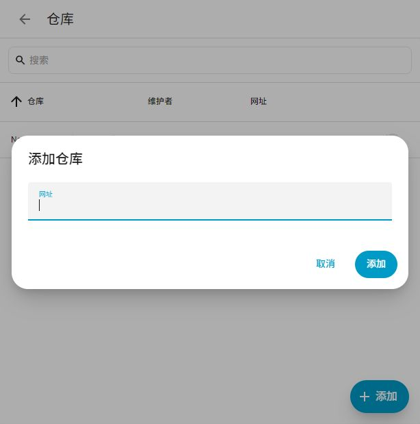
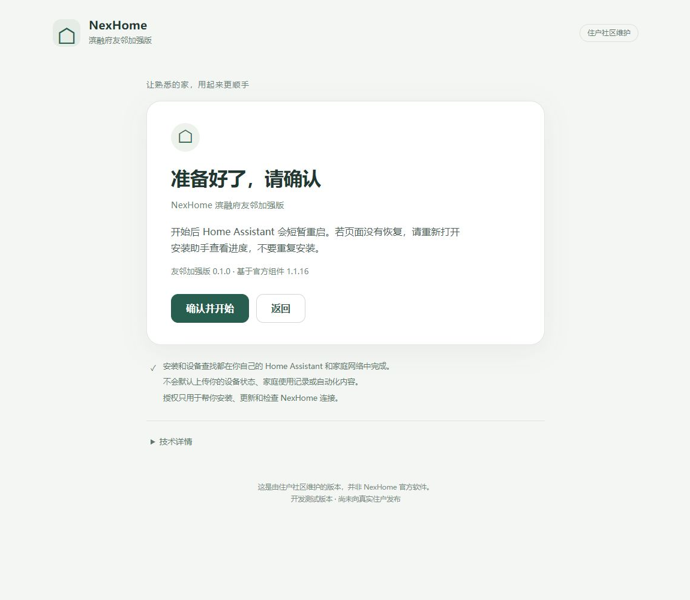
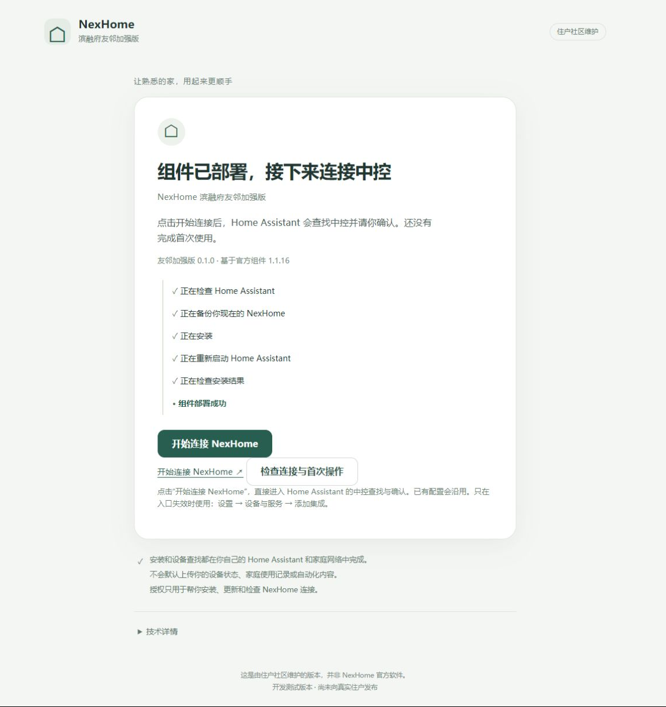
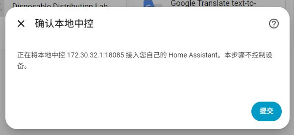
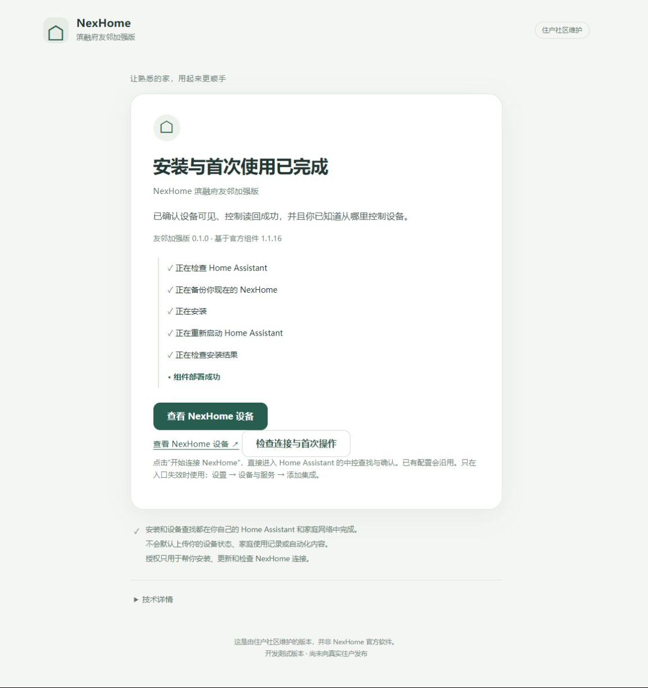

# NexHome 滨融府友邻加强版：安装与使用指南

面向已经有 Home Assistant 的**滨融府大平层住户**。**正式发布版本 v0.1.0**，上游基础 v1.1.16；属于住户社区增强版本。

项目仓库和 [v0.1.0 Release](https://github.com/Doggiekong/nexhome-neighbor-edition/releases/tag/v0.1.0) 已公开。安装只从本项目入口开始，固定包会经过 hash 校验；不用提前复制源码或填写维护者参数。此前隔离验证的截图注明模拟设备，历史记录保留在[RC 分发验证](rc-distribution-bootstrap.md)。

<a id="choose-route"></a>
## 一、先判断自己的 Home Assistant 类型

使用自己的管理员账号打开 HA。到 **设置 → 系统 → 修复 → 右上角 ⋮ → 系统信息**，看 **Installation type / 安装类型**，不按 NAS 或机器品牌猜。


系统信息图来自 [HA 官方说明](https://www.home-assistant.io/more-info/system-information/)，不是本轮新截图；图中版本可能不同。

| 显示的类型 | 只选一条路线 |
|---|---|
| Home Assistant OS | [A：App 安装](#route-a) |
| Home Assistant Container / Docker | [B：Terminal 安装](#route-b) |
| 其他或不确定 | 先让本机管理员确认，未验证不等于不支持 |

两种方式是替代关系，不是前后步骤。都使用同一个固定 0.1.0 安装包和 Installer Core，最终进入 HA 原生配置；**设备出现、首次操作读回成功并确认知道控制入口后才是 READY**。

先保留 HA 备份，确认 HA 与 NexHome 在同一可通信的家庭网络。典型单中控环境通常不需要预先找 IP、IOTID 或 SN。已有安装沿用原 entry，不删除重建。当前兼容性主要基于滨融府大平层实测交付组合；其他户型可能可用，但尚未完整验证。

<a id="route-a"></a>
## 二、A：Home Assistant OS — App 路线

### A1. 从 GitHub 项目页添加仓库

打开 [GitHub 项目](https://github.com/Doggiekong/nexhome-neighbor-edition)，选择 **添加到 Home Assistant**。官方 My Home Assistant 页面会引导打开自己的 HA，再确认添加仓库。仓库地址为 `https://github.com/Doggiekong/nexhome-neighbor-edition`。不需要 GitHub 密码或个人 token，不在地址中塞入凭据。

也可以打开 **设置 → 应用 → 安装应用 → 右上角 ⋮ → 仓库 → 添加**。从同一项目入口复制完整仓库地址，不 clone、不 SSH 复制 App 目录。




### A2. 安装并启动助手

找到 **NexHome 滨融府友邻加强版**，点 **安装**；完成后点 **启动**。看到“运行中”再点 **打开网页界面**。不要安装另一条 Terminal 路线。


### A3. 检查、预览、确认

点 **开始检查**，阅读检测结果，再点 **开始安装**。已有官方版会先备份并保留设备身份、名字、隐藏、房间和引用。来源不明或 HACS 管理冲突时会停止，不要删除 HA 的 NexHome 配置。


阅读预览后点 **确认并开始**。HA 会短暂重启；暂时断开时重新打开助手查看保存的进度，**不要重新安装**。



### A4. 部署之后继续连接

看到 **组件已部署，接下来连接中控**，点 **开始连接 NexHome**。这时只是部署完成，还没有完成首次使用。已有配置直接沿用，不重复创建。



接下来按[第四节](#connect-home)确认中控和设备，再完成首次操作。**不要回头执行 B。**

<a id="route-b"></a>
## 三、B：Container / Docker / NAS / Linux — Terminal 路线

### B1. 打开运行 HA 的主机 Terminal

NAS 用户打开原有管理界面的主机终端；Linux 用户打开已有 Terminal/控制台；原来通过 SSH 管理的继续用原来的入口。这里需要管理 **HA 所在的主机**，不是随便一个容器。只有 HA 网页而不知道主机入口时，先请本机管理员协助，不新开公网端口。

已实测 Linux Docker、可写主机目录绑定的 `/config`、运行中的官方 HA 镜像。主机需要 Python 3、curl、sha256sum 和现有 Docker 管理权限；不升级主机 Python、不拉取替代 HA 镜像。命名卷、自定义 TLS、非 Docker 环境等尚未实机验收，检测不确定会用中文停止说明。

### B2. 从同一项目入口复制唯一的一整行

从 [GitHub 项目](https://github.com/Doggiekong/nexhome-neighbor-edition) 打开本指南，复制下面**完整一行**，粘贴到运行 HA 的主机 Terminal，再按回车。不要修改任何文字：

```sh
sh -c 'd=$(mktemp -d); trap '"'"'rm -f "$d/start.sh"; rmdir "$d"'"'"' EXIT; curl -fsSL --proto "=https" --proto-redir "=https" --connect-timeout 10 --max-time 60 https://github.com/Doggiekong/nexhome-neighbor-edition/releases/download/v0.1.0/start.sh -o "$d/start.sh" && echo "9ee729ad1672753ed9a8f2626b3461eecba89d80116f8af43a0c1c80f4402e16  $d/start.sh" | sha256sum -c - >/dev/null && sh "$d/start.sh"'
```

入口会下载固定 Bootstrap，校验启动器，然后从同一正式 v0.1.0 Release 下载并校验 frontend 与安装包，再启动同一个 Installer Core。机器无需预先拥有 Neighbor 源码。**0 处修改命令，0 个维护者环境变量，不手填路径、容器名、HA URL、版本、hash 或 JSON。**

只认本项目的固定 Release 来源。不使用 main.zip，不把陌生群里的脚本当作入口。网络或校验失败会停止，不偷偷改装其他版本。

### B3. 按界面选择，不改命令

1. 找到一个 HA 时自动选中；多个 HA 时用 **↑ / ↓ / Enter** 选择。
2. 确认只检查这台 HA 的本机 Docker 和配置目录。
3. 在终端输入**自己的 HA 用户名和密码**，密码隐藏输入。它们只用于本机当前会话，不上传给项目，不写命令参数/环境变量，退出时撤销临时授权。
4. 阅读当前安装来源和预览，按 Enter **开始安装**；需要时选择“查看技术详情”。
5. 等待部署和健康检查完成，再按终端给出的地址回到 HA 完成原生连接。
6. 看见设备、完成首次控制并核对实际状态后，回终端按 Enter 检查 READY。证据不足不会提前显示完成。

本轮单候选实测：**复制 1 行，修改 0 处，回车 6 次**（启动 1 次、菜单 3 次、用户名和密码各 1 次）。有两个自由文本字段：HA 用户名和密码，这是登录本机所需的认证，不是让住户填写安装参数。多个候选额外使用方向键和一次确认。

没有找到 HA、权限不足、文件来源不一致或恢复未完成时，先读中文说明；“查看技术详情”才显示内部代号。不要照着代号反复覆盖。不安全的已有安装会停止，原 entry 不删除。

**现在继续[第四节](#connect-home)，不要再装 App。**

<a id="connect-home"></a>
## 四、连接家里的NexHome

### 新安装

点击连接入口后，HA可能先问“您想要设置此集成吗？”，点“确定”进入。随后自动查找：只有一个中控时，核对后点“提交”；多个时先选择自己的中控，再确认。系统不会静默替您添加未知中控。完成后可以在“命名和分配”页面整理设备，或点“跳过并完成”稍后整理。

没有找到时，可以重试，确认HA与中控网络可达。只有直接入口无效时才用最后的备用路径：**设置 → 设备与服务 → 添加集成 → NexHome 滨融府友邻加强版**。高级手动参数只在确实需要时由维护者协助，不作为普通流程。



### 已经用过官方或旧版组件

**不要删除原来的NexHome。** 正常升级沿用原配置、名称、隐藏状态、房间和引用，不重新发现一个重复中控。如果原连接离线，应先检查原因，不要靠删除重建“解决”。HACS管理的安装会要求按正常HACS界面交接更新责任，保留HA里的条目。

## 五、第一次看到并控制设备

1. 打开 **设置 → 设备与服务 → NexHome 滨融府友邻加强版**。
2. 点设备数量或设备列表，找到“客厅主灯”等自己的设备。
3. 打开设备的控制项，先对一盏合适的灯开一次、关一次。看实际灯是否动作，并确认HA状态随后一致。
4. 回安装助手点“检查连接与首次操作”。真实状态已读回后，确认“我已找到设备并完成首次操作”，才显示安装与首次使用完成。

终端路线同样先按原生链接进入设备并完成第一次操作，不把终端退出码0当成所有设备已经可用。助手机器人不会为了点亮“完成”而自动开关家里设备。




### 在自己的首页添加控制卡片

默认概览能自然显示部分设备；已有自定义页面不会被本项目改动。要自己整理时，先到 **设置 → 仪表盘 → 添加仪表盘 → 从新建仪表盘开始**，取名“NexHome”，按提示填页面地址并创建。

打开新页面，点编辑铅笔 → 添加卡片 → 按实体，搜索并选择一盏灯或窗帘，点击建议的“磁贴”卡片添加，最后点页面上方“完成”。已有可编辑页面可直接添加，不必重复新建。先放常用设备，不必一次整理全屋。


没有位置反馈的窗帘可能显示unknown/未知，仍可明确开/关/停；不要据此填一个假的百分比。

## 六、装好以后，推荐先做这5件事

### 1. 整理房间

到 **设置 → 区域、标签与地点 → 区域** 建立“客厅”“书房”等房间；再进入设备页选择所属房间。房间只是帮助找设备，不会改变线路。先整理两个常用房间即可。


### 2. 建一个“客厅灯”设备组

打开 **设置 → 设备与服务 → 辅助元素 → 创建辅助元素 → 群组 → 灯组**。取名“客厅灯”，选择客厅主灯，用“添加实体”继续选择灯带、射灯，再点“提交”和“完成”。保持“所有实体”关闭，这样只要一盏亮着，灯组就显示开启。以后点一次控制整组；成员只选同一房间实际展示的灯，别把底层隐藏开关重复加进去。


### 3. 建一个“观影模式”场景

打开 **设置 → 自动化与场景 → 场景 → 创建场景**。在“实时编辑”中添加客厅主灯、灯带、窗帘，再按想要的状态调好。添加后可切换“预览模式”查看细节；预览模式不能新增成员。最后点“保存”，命名“观影模式”。示例为主灯关闭、灯带打开、窗帘关闭。

场景是“一次把几台设备变成想要的样子”。点场景或一句语音就可触发。**在真实环境编辑场景时，界面操作可能立即影响选中的设备，先确认家人方便再试。**


### 4. 建时间/日落自动化

自动化可以理解为三个部分：**何时发生 → 满足什么条件 → 做什么事**。从设置 → 自动化与场景 → 创建自动化 → 创建新的自动化开始，按下面例子逐项选择，不需要写代码。


#### 示例1：每天早上07:00开指定窗帘

1. 添加触发条件，选择“时间”，再选“在特定时间或特定日期触发”的“时间”，填07:00。
2. 添加动作，选择“打开窗帘”，目标只选要开的那一组。
3. 保存为“早上开客厅窗帘”。第一次手动运行时在现场观察，确认没有选错。


#### 示例2：工作日早晨开卫生间灯，再按时关闭

拆成两条最容易理解：

- “工作日早灯”：触发时间06:50；条件选择“时间”，只勾周一到周五；动作“打开灯”，选指定灯。
- “工作日关早灯”：触发时间07:30；同样的工作日条件；动作“关闭灯”，选同一盏灯。

保存前看清目标，不要选成整个房间的灯组。图中用通用测试灯示意，不在私密房间实测。

#### 示例3：每天太阳落山后关窗帘

1. 添加触发条件，选择“太阳”，再选“日落（日落时触发）”；不填固定18:00。
2. 添加动作“关闭窗帘”，选目标。
3. 保存为“日落关客厅窗帘”。

HA会按每天日落时间触发，因此需要“家”的大致位置正确；夏天、冬天的日落不同。[官方触发器说明](https://www.home-assistant.io/docs/automation/trigger/#sun-trigger)


### 5. 开启手机定位，试回家/离家自动化

先按后面的“在手机上使用”登录，再按“家与定位”检查权限和家范围。先观察几天在家/离家显示是否可信，再允许自动关整屋灯。不是先写自动化再等定位“自然准确”。

## 七、在手机上使用

**iPhone和Android用户请安装官方Home Assistant App。**

安装后，登录自己的Home Assistant，就可以在手机上查看和控制已经接入的NexHome灯光、窗帘、空调等设备。后面的定位、到家/离家自动化和通知功能，也都通过Home Assistant App完成。

- iPhone：[官方App Store入口](https://apps.apple.com/app/home-assistant/id1099568401)，名称Home Assistant。
- Android：[官方Google Play入口](https://play.google.com/store/apps/details?id=io.homeassistant.companion.android)，名称Home Assistant。
- 也可从[官方移动端下载页](https://companion.home-assistant.io/download/)进入；无法访问对应商店时先查官方说明，不安装同名来历不明的软件。


第一次在家中Wi-Fi打开App，选择自己的HA；没找到时输入自己原来能打开的HA地址，使用自己的HA账号登录。登录后的控制页面就是自己的HA页面。

如果希望使用“到家自动开灯”“全家离家后自动关灯”，下一节会介绍必要的位置权限。这里先完成下载和登录即可。[官方首次登录说明](https://companion.home-assistant.io/docs/getting_started/)

## 八、家与定位：先观察，再自动化

### 设置“家”

打开 **设置 → 区域、标签与地点 → 地点**，编辑“家/Home”。把中心放在自己家的大致位置，范围可以先设约100米，再根据实际定位表现调整。不要把测试图中的示意位置照搬到家里。


100米是示例范围，不是绝对精度。GPS、手机系统后台、节电设置和网络都会影响及时性；坐在家里却显示离家时，先检查定位和家庭区域，别急着执行自动关灯。

### 给手机必要权限

- iPhone：系统设置 → 隐私与安全性 → 定位服务 → Home Assistant；按系统提示允许后台所需的位置权限、精确位置。后台功能一般需要“始终”，界面可能先询问“使用期间”再询问“始终”。
- Android：Home Assistant的应用权限中允许需要的位置/后台定位，并检查应用里的位置追踪开关及节电限制；不同厂商菜单不同。
- 每位成员用自己的账号和手机；在HA“人员”里将对应手机关联给对应人员。只观察到一个手机，不能代表全家。

离家时，手机还需能把状态传回HA；远程访问未打通或VPN断开，位置更新可能延迟。[官方定位说明](https://companion.home-assistant.io/docs/core/location/)

### 示例4A：夜间回家开客厅灯

1. 触发器选“区域”，对象选自己的人员，区域“家”，事件“进入”。
2. 条件选“状态”，选择“太阳”，状态选“地平线以下”（表示夜间）。
3. 动作选“打开灯”，目标“客厅灯”。
4. 保存后先观察定位变化和自动化运行记录，确认没有反复误触发。

### 示例4B：所有家庭成员都离家后关灯

**多成员家庭不能只用“我的手机离家”就关闭全屋灯。**

1. 先确认每位常住成员都正确关联手机；有人没带手机、定位离线或未纳入名单时，不启用整屋关闭。
2. 触发器用“家区域人数变为0”，可加持续几分钟后再判断。
3. 条件再次核对每位成员明确处于离家；unknown/unavailable不能当作离家。
4. 动作只选核对过的灯组，先从客厅试起。客人或保洁可能仍在家时，加手动“暂停离家自动化”的开关，或保持手动控制。

单人家庭也先验证自己的定位可靠。人员/区域人数条件需要本户实际名单和权限；本轮只验证编辑界面与逻辑，没有以真实手机离家做现场验收。

## 九、通知

在手机允许Home Assistant通知权限后，自动化动作里选择对应手机的“发送通知”，先只给自己发一条“测试通知”。确认目标手机正确，再加到需要的自动化里。不要把设备故障告警误发给所有家庭成员。本文不替您创建通知或改变已有摄像头通知。

## 十、用语音控制家里的设备

### 滨融府大平层原配家庭语音中控

友邻加强版只增强HA接入，不主动修改开发商NexHome Hub或原有语音系统，设计目标是原控制方式继续正常。**NOT YET VERIFIED：当前没有完成对应中控实机验收，不能写成兼容已通过。**

未来获得单独试点授权后，检查表应记录安装前品牌/型号、可控设备、示例命令；安装后重复相同命令，逐项确认。本轮不启动Pilot。

### HA可以扩展的语音平台

| 方式 | 可以尝试的方向 | 本项目证据状态 |
|---|---|---|
| Home Assistant Assist | 使用HA支持的语音入口、语言和暴露设备 | NOT YET VERIFIED |
| Apple Home / Siri | 在HA配置对应桥接后控制暴露设备 | NOT YET VERIFIED |
| Google Assistant | 按HA官方支持路径连接 | NOT YET VERIFIED |
| Alexa | 按HA官方支持路径连接 | NOT YET VERIFIED |
| 滨融府大平层原配家庭语音中控 | 预期保持原功能 | NOT YET VERIFIED |

VERIFIED表示实际通过；NOT YET VERIFIED表示未验收；UNSUPPORTED只用于有明确不支持证据的型号/路径，不能拿未测当不支持。本轮没有语音路径达到实机VERIFIED。

例子：“打开客厅灯”“把客厅灯调暗一点”“关闭窗帘”“把空调调到24度”“启动观影模式”。一句话执行场景比只开一盏灯更方便；实际支持取决于语音平台、设备暴露和命名。[HA官方语音入口](https://www.home-assistant.io/voice_control/)

## 十一、出门以后还能用吗？

如果已经能在外面打开自己的HA，已接入设备仍从那里操作。如果只能在家Wi-Fi用，需要单独解决HA远程访问。

- 最省事：Home Assistant Cloud。
- 有NAS/服务器/域名：HTTPS及反向代理。
- VPN类：Tailscale、WireGuard或自己已有VPN。
- Tunnel类：Cloudflare Tunnel等，需要自行评估账户、认证和服务边界。

这里不展开网络部署教程。友邻加强版不自动改路由器、不自动开公网端口、不自动建立远程控制通道。远程访问方案和手机实机联动本轮未现场验证。[HA官方远程访问说明](https://www.home-assistant.io/docs/configuration/remote/)

## 十二、安全与遇到问题

先用灯、窗帘、普通场景练习。门锁、燃气、大功率电器和无人时运行的设备不作为新手自动化示例。多成员在家判断、手机定位误差、设备离线都应按“不确定”处理，不自动推断安全。

- 没找到中控：重试并检查家庭网络；不扫描全网、不擅改路由器。
- 已有条目不可用：保留原条目，先检查连接；不删除重建。
- 显示组件部署成功：继续连接和首次操作，不反复重装。
- 控制未确认：看设备真实状态，不靠一直点击重试；记录脱敏错误给维护者。
- 恢复未完成：停止操作，保留备份；不要认为换回代码一定能撤销所有设置变化。

不要发送密码、token、完整SN/IOTID、家庭成员或精确位置截图。手册图片只展示测试数据。自定义Dashboard、房间和自动化都由您自己决定是否修改。

## 本文验证边界

新的分发入口、原生配置和 READY 于本轮在隔离 VM201/VM400 实际验证；本轮截图位于 manual-images/distribution。图中的中控与五个设备均为模拟数据，不是本轮真实 Hub 测试。其余使用章节沿用既有隔离 HA2026.10.2、官方 App 网页和系统信息示例，来源另有标示。示例自动化只用于说明和测试环境编辑，不代表已在真实家庭执行。手机实机、原语音中控、所有语音平台、其他NAS、远程访问、多户长期运行尚未验收。

License / publication authorization: **USER MANAGED / OUTSIDE TECHNICAL GATE**。本项目是社区改进版本，不代表官方团队或官方授权。

[回到项目首页](../README.md) · [当前RC状态](rc-status.md) · [Stage E历史验证](phase2-stagee-validation.md) · [来源与致谢](../NOTICE.md)

## 致谢

### 邻居 Neil

**特别感谢邻居 Neil，他的 NexHome Home Assistant 项目为本项目提供了不少参考和启发。**

技术参考项目：[Neil-UWA/nexhome-homeassistant-component](https://github.com/Neil-UWA/nexhome-homeassistant-component)

### NexHome 官方

感谢 [NexHome 官方 Home Assistant integration](https://github.com/nexhome-org/nexhome-homeassistant-component) 提供原始开发基础。Upstream base：v1.1.16。
