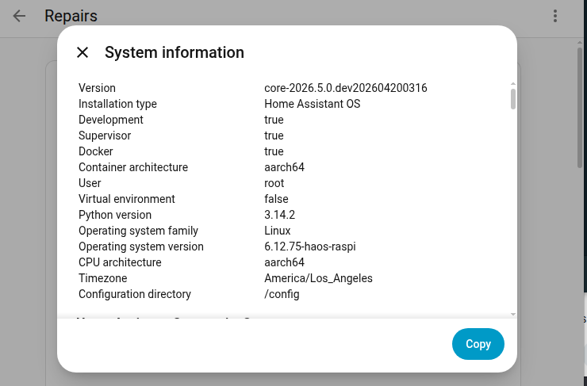
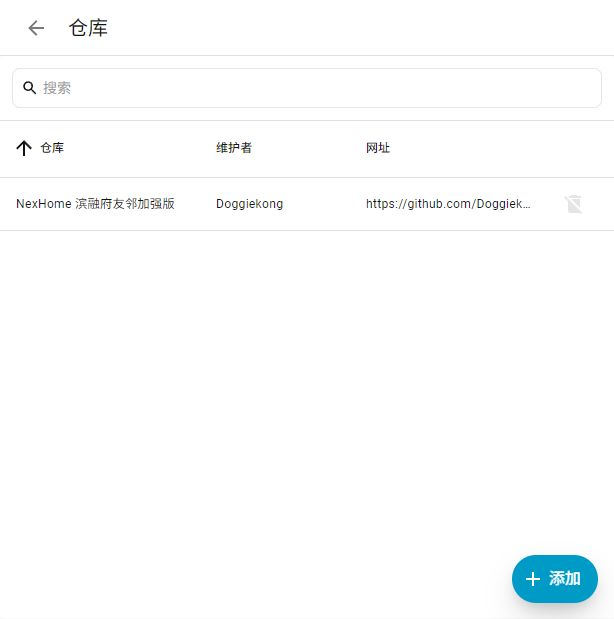
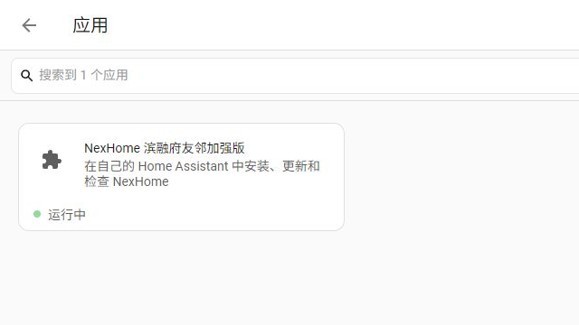
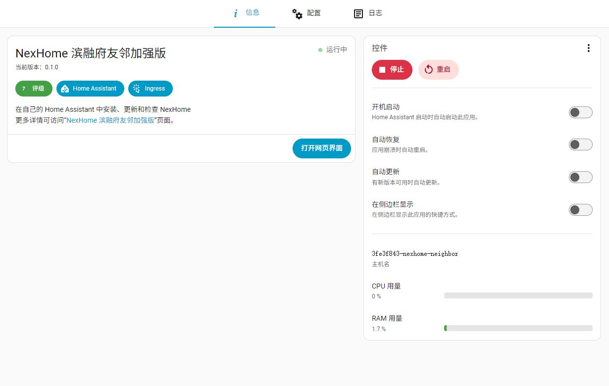
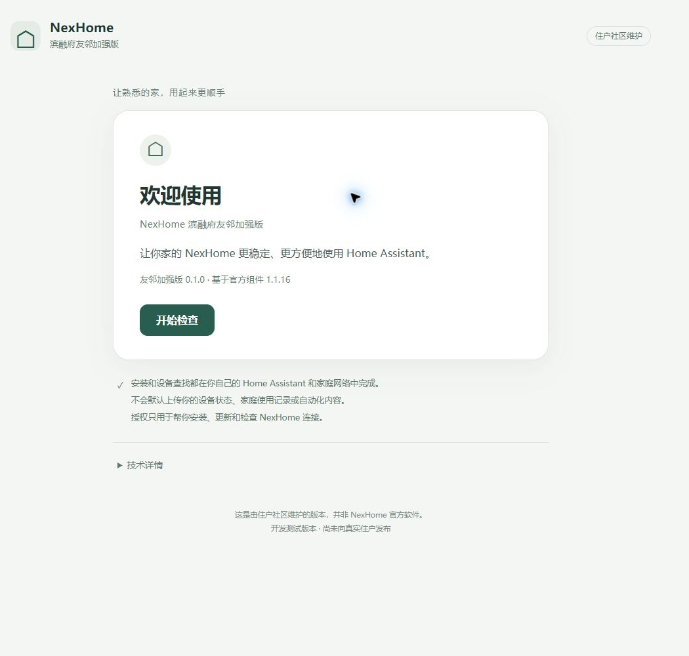
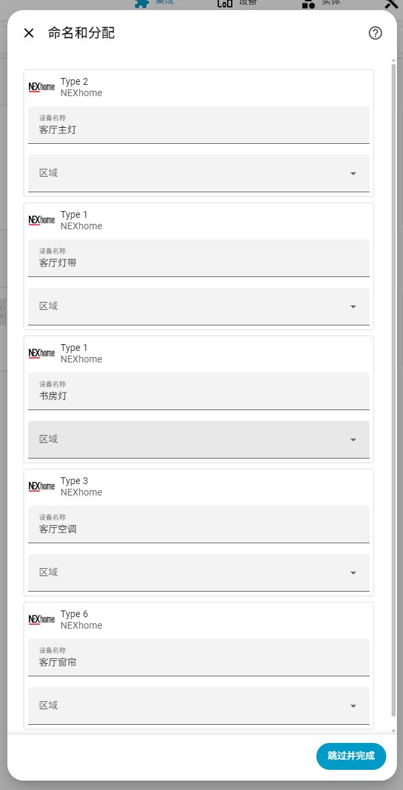

# NexHome 滨融府友邻加强版：安装与使用指南

这份指南面向已经有 Home Assistant 的滨融府大平层住户。先确认自己使用的是 Home Assistant OS，还是 Container / Docker 环境，再选择对应安装方式。

<a id="choose-route"></a>
## 一、先确认 Home Assistant 安装类型

打开 **设置 → 系统 → 修复 → 右上角 ⋮ → 系统信息**，查看 **Installation type / 安装类型**。




系统信息示例来自 [Home Assistant 官方说明](https://www.home-assistant.io/more-info/system-information/)，界面版本可能不同。

| 安装类型 | 选择路线 |
|---|---|
| Home Assistant OS | [A：Home Assistant OS](#route-a) |
| Home Assistant Container / Docker | [B：Terminal 安装](#route-b) |
| 其他或不确定 | 暂未完整验证，先确认当前安装方式 |

两种方式只需要选择一种。**安装前先备份 Home Assistant**，确认它与 NexHome 中控可以在家庭网络中通信。已经用过 NexHome 的，请保留原有配置，不要删除后重新添加。

<a id="route-a"></a>
## 二、A：Home Assistant OS

### A1. 从 GitHub 添加安装仓库

打开 [GitHub 项目](https://github.com/Doggiekong/nexhome-neighbor-edition)，点击 **添加到 Home Assistant**。

浏览器会打开 My Home Assistant，并引导进入自己的 Home Assistant。按页面提示确认添加仓库即可；如果页面中的 Home Assistant 地址不是自己的，先改成自己平时使用的地址。

如果按钮不能正常使用，可以打开 **设置 → 应用 → 安装应用 → 右上角 ⋮ → 仓库 → 添加**，粘贴：

`https://github.com/Doggiekong/nexhome-neighbor-edition`



### A2. 安装并启动友邻加强版

找到 **NexHome 滨融府友邻加强版**，点击 **安装**。完成后点击 **启动**，看到“运行中”后，点击 **打开网页界面**。




### A3. 检查并确认安装

点击 **开始检查**，阅读检查结果，再按提示继续。安装前会备份；已有设备名称、房间和自动化会尽量保留。无法确认安全时会先停止，请不要删除现有 NexHome 配置来解决问题。



阅读安装说明，点击 **确认并开始**。Home Assistant 会短暂重启；如果页面断开，稍后重新打开助手查看进度，不要重复开始安装。

### A4. 返回 Home Assistant 连接 NexHome

安装后点击 **开始连接 NexHome**，继续按[第四节](#connect-home)确认中控，再找一盏灯试一次控制。已有连接会继续使用，不会重复添加。

<a id="route-b"></a>
## 三、B：NAS / Docker / Container / Linux

### B1. 打开原有主机管理入口

在运行 Home Assistant 的 NAS 或 Linux 主机上，打开自己原来使用的终端或控制台。如果不知道主机入口，先请本机管理员协助。

主机需要已有 Docker 管理权限，以及 Python 3、curl 和 sha256sum；缺少工具时请管理员协助。当前重点验证了 Linux Docker，其他环境请先确认安装方式。

### B2. 整行复制，按回车

复制下面**完整一行**到主机终端，按回车。不要修改：

```sh
sh -c 'd=$(mktemp -d); trap '"'"'rm -f "$d/start.sh"; rmdir "$d"'"'"' EXIT; curl -fsSL --proto "=https" --proto-redir "=https" --connect-timeout 10 --max-time 60 https://github.com/Doggiekong/nexhome-neighbor-edition/releases/download/v0.1.0/start.sh -o "$d/start.sh" && echo "9ee729ad1672753ed9a8f2626b3461eecba89d80116f8af43a0c1c80f4402e16  $d/start.sh" | sha256sum -c - >/dev/null && sh "$d/start.sh"'
```

只从本项目入口取得安装命令，不执行来历不明的脚本。下载或文件检查失败时，安装会停止。

### B3. 按菜单继续

1. 安装助手会自动寻找 Home Assistant；找到多个时，用 **↑ / ↓ / Enter** 选择自己的那一台。
2. 阅读权限提示，继续检查。
3. 登录一次自己的 Home Assistant。账号和密码只用于当前安装过程，不会上传到项目；密码输入时不会显示。
4. 阅读安装前检查结果，确认后选择 **开始安装**。
5. 等待安装完成，再打开终端给出的 Home Assistant 地址，继续连接 NexHome。
6. 设备出现并完成第一次操作后，回终端检查是否完成；也可以选择稍后继续。

遇到来源不明或恢复未完成等问题时，先按提示处理，不要反复重装或删除原有配置。排查时可以选择“查看技术详情”。

<a id="connect-home"></a>
## 四、连接 NexHome

### 第一次安装

点击连接入口后，Home Assistant 可能先问“您想要设置此集成吗？”，点击“确定”。只有一个中控时，核对后提交；有多个时，先选择自己的中控，再确认。完成后可以命名和分配房间，也可以稍后整理。

没找到时，确认 Home Assistant 和中控能在家庭网络中通信，再重试。连接按钮无效时，可以到 **设置 → 设备与服务 → 添加集成 → NexHome 滨融府友邻加强版**。高级手动配置只在确实需要时使用。

### 已经使用过 NexHome

**不要删除原来的 NexHome 配置。** 正常升级会沿用设备名称、隐藏状态、房间和自动化引用。原连接不可用时，先检查网络和中控，不要删除重建。

如果助手发现你以前通过 HACS 安装过 NexHome，会单独提示操作：先在 HACS 中停止由它管理这个组件，Home Assistant 里的 NexHome 设备和设置要保留。按助手指引完成后，返回重新检查。

## 五、第一次控制设备

打开 **设置 → 设备与服务 → NexHome 滨融府友邻加强版**，进入设备列表：

1. 找到一盏方便测试的灯。
2. 开一次，再关一次。
3. 看实际灯有没有动作。
4. 看 Home Assistant 里的状态是否跟着变化。

然后回安装助手点击“检查连接与首次操作”，按提示确认已经找到设备并完成首次操作。Terminal 路线回终端按菜单检查即可。安装助手不会自动替你开关设备。




### 在自己的首页添加控制卡片

默认概览能自然显示部分设备；已有自定义页面不会被本项目改动。要自己整理时，先到 **设置 → 仪表盘 → 添加仪表盘 → 从新建仪表盘开始**，取名“NexHome”，按提示填页面地址并创建。

打开新页面，点编辑铅笔 → 添加卡片 → 按实体，搜索并选择一盏灯或窗帘，点击建议的“磁贴”卡片添加，最后点页面上方“完成”。已有可编辑页面可直接添加，不必重复新建。先放常用设备，不必一次整理全屋。


没有位置反馈的窗帘可能显示“未知”，仍可明确开/关/停；不要据此填一个假的百分比。

## 六、装好以后，推荐先做这5件事

### 1. 整理房间

到 **设置 → 区域、标签与地点 → 区域** 建立“客厅”“书房”等房间；再进入设备页选择所属房间。房间只是帮助找设备，不会改变线路。先整理两个常用房间即可。


### 2. 建一个“客厅灯”设备组

打开 **设置 → 设备与服务 → 辅助元素 → 创建辅助元素 → 群组 → 灯组**。取名“客厅灯”，选择客厅主灯，用“添加实体”继续选择灯带、射灯，再点“提交”和“完成”。保持“所有实体”关闭，这样只要一盏亮着，灯组就显示开启。以后点一次控制整组；成员只选同一房间实际展示的灯，别把底层隐藏开关重复加进去。


### 3. 建一个“观影模式”场景

打开 **设置 → 自动化与场景 → 场景 → 创建场景**。在“实时编辑”中添加客厅主灯、灯带、窗帘，再按想要的状态调好。添加后可切换“预览模式”查看细节；预览模式不能新增成员。最后点“保存”，命名“观影模式”。示例为主灯关闭、灯带打开、窗帘关闭。

场景是“一次把几台设备变成想要的样子”。点场景或一句语音就可触发。**在真实环境编辑场景时，界面操作可能立即影响选中的设备，先确认家人方便再试。**


### 4. 建时间/日落自动化

自动化可以理解为三个部分：**何时发生 → 满足什么条件 → 做什么事**。从设置 → 自动化与场景 → 创建自动化 → 创建新的自动化开始，按下面例子逐项选择，不需要写代码。


#### 示例1：每天早上07:00开指定窗帘

1. 添加触发条件，选择“时间”，再选“在特定时间或特定日期触发”的“时间”，填07:00。
2. 添加动作，选择“打开窗帘”，目标只选要开的那一组。
3. 保存为“早上开客厅窗帘”。第一次手动运行时在现场观察，确认没有选错。


#### 示例2：工作日早晨开卫生间灯，再按时关闭

拆成两条最容易理解：

- “工作日早灯”：触发时间06:50；条件选择“时间”，只勾周一到周五；动作“打开灯”，选指定灯。
- “工作日关早灯”：触发时间07:30；同样的工作日条件；动作“关闭灯”，选同一盏灯。

保存前看清目标，不要选成整个房间的灯组。

#### 示例3：每天太阳落山后关窗帘

1. 添加触发条件，选择“太阳”，再选“日落（日落时触发）”；不填固定18:00。
2. 添加动作“关闭窗帘”，选目标。
3. 保存为“日落关客厅窗帘”。

HA会按每天日落时间触发，因此需要“家”的大致位置正确；夏天、冬天的日落不同。[官方触发器说明](https://www.home-assistant.io/docs/automation/trigger/#sun-trigger)


### 5. 开启手机定位，试回家/离家自动化

先按后面的“在手机上使用”登录，再按“家与定位”检查权限和家范围。先观察几天在家/离家显示是否可信，再允许自动关整屋灯。不是先写自动化再等定位“自然准确”。

## 七、在手机上使用

**iPhone和Android用户请安装官方Home Assistant App。**

安装后，登录自己的Home Assistant，就可以在手机上查看和控制已经接入的NexHome灯光、窗帘、空调等设备。后面的定位、到家/离家自动化和通知功能，也都通过Home Assistant App完成。

- iPhone：[官方App Store入口](https://apps.apple.com/app/home-assistant/id1099568401)，名称Home Assistant。
- Android：[官方Google Play入口](https://play.google.com/store/apps/details?id=io.homeassistant.companion.android)，名称Home Assistant。
- 也可从[官方移动端下载页](https://companion.home-assistant.io/download/)进入；无法访问对应商店时先查官方说明，不安装同名来历不明的软件。


第一次在家中Wi-Fi打开App，选择自己的HA；没找到时输入自己原来能打开的HA地址，使用自己的HA账号登录。登录后的控制页面就是自己的HA页面。

如果希望使用“到家自动开灯”“全家离家后自动关灯”，下一节会介绍必要的位置权限。这里先完成下载和登录即可。[官方首次登录说明](https://companion.home-assistant.io/docs/getting_started/)

## 八、家与定位：先观察，再自动化

### 设置“家”

打开 **设置 → 区域、标签与地点 → 地点**，编辑“家/Home”。把中心放在自己家的大致位置，范围可以先设约100米，再根据实际定位表现调整。不要把测试图中的示意位置照搬到家里。


100米是示例范围，不是绝对精度。GPS、手机系统后台、节电设置和网络都会影响及时性；坐在家里却显示离家时，先检查定位和家庭区域，别急着执行自动关灯。

### 给手机必要权限

- iPhone：系统设置 → 隐私与安全性 → 定位服务 → Home Assistant；按系统提示允许后台所需的位置权限、精确位置。后台功能一般需要“始终”，界面可能先询问“使用期间”再询问“始终”。
- Android：Home Assistant的应用权限中允许需要的位置/后台定位，并检查应用里的位置追踪开关及节电限制；不同厂商菜单不同。
- 每位成员用自己的账号和手机；在HA“人员”里将对应手机关联给对应人员。只观察到一个手机，不能代表全家。

离家时，手机还需能把状态传回HA；远程访问未打通或VPN断开，位置更新可能延迟。[官方定位说明](https://companion.home-assistant.io/docs/core/location/)

### 示例4A：夜间回家开客厅灯

1. 触发器选“区域”，对象选自己的人员，区域“家”，事件“进入”。
2. 条件选“状态”，选择“太阳”，状态选“地平线以下”（表示夜间）。
3. 动作选“打开灯”，目标“客厅灯”。
4. 保存后先观察定位变化和自动化运行记录，确认没有反复误触发。

### 示例4B：所有家庭成员都离家后关灯

**多成员家庭不能只用“我的手机离家”就关闭全屋灯。**

1. 先确认每位常住成员都正确关联手机；有人没带手机、定位离线或未纳入名单时，不启用整屋关闭。
2. 触发器用“家区域人数变为0”，可加持续几分钟后再判断。
3. 条件再次核对每位成员明确处于离家；“未知”或“不可用”不能当作离家。
4. 动作只选核对过的灯组，先从客厅试起。客人或保洁可能仍在家时，加手动“暂停离家自动化”的开关，或保持手动控制。

单人家庭也先验证自己的定位可靠。人员和家庭成员名单需要按自己家的情况设置。

## 九、通知

在手机允许Home Assistant通知权限后，自动化动作里选择对应手机的“发送通知”，先只给自己发一条“测试通知”。确认目标手机正确，再加到需要的自动化里。不要把设备故障告警误发给所有家庭成员。

## 十、用语音控制家里的设备

### 原配语音中控

友邻加强版不会主动修改开发商原有的 NexHome 中控和语音系统。我们目前还没有专门对原配语音中控做完整实测，因此暂时不把它列为已验证功能。

### Home Assistant 语音

可以了解 Home Assistant Assist、Apple Home / Siri、Google Assistant 和 Alexa。这些属于 Home Assistant 自己的扩展能力，需要另外配置，本项目目前没有逐项实测。

配置好以后，可以尝试“打开客厅灯”“关闭窗帘”“把空调调到24度”或“启动观影模式”。实际支持取决于所用平台、设备和命名。[Home Assistant 官方语音说明](https://www.home-assistant.io/voice_control/)

## 十一、远程访问

如果已经能在外面打开自己的 Home Assistant，可以继续从那里控制设备。如果只能在家中 Wi-Fi 使用，需要另外设置远程访问：

- Home Assistant Cloud。
- 自己已有的 HTTPS / 反向代理。
- VPN，例如 Tailscale、WireGuard。
- Tunnel，例如 Cloudflare Tunnel。

远程访问是 Home Assistant 本身的功能，不由友邻加强版自动配置。这里不展开部署教程，也不会自动改路由器或开放公网端口。[官方远程访问说明](https://www.home-assistant.io/docs/configuration/remote/)

## 十二、遇到问题

- **没找到中控**：确认家庭网络连接正常后重试，不要先改路由器。
- **原来的 NexHome 不可用**：保留原有设备与配置，先检查连接，不要删除重建。
- **已经安装，但没有设备**：继续“开始连接 NexHome”，不要反复安装。
- **操作后状态不对**：先看实际设备，不要连续点击重试。可在“技术详情”中保存诊断信息，请维护者协助。
- **提示恢复未完成**：停止操作并保留备份，按恢复指引处理。重新放回旧文件不一定能恢复全部设置。

不要把密码、访问令牌或中控识别信息发给别人；发截图前遮住家庭成员、精确位置等私人信息。

先用灯光、窗帘和普通场景练习。门锁、燃气和大功率电器不作为入门自动化示例；定位或设备状态不确定时，不要据此执行有风险的动作。

## 当前已验证范围

当前主要基于滨融府大平层原配 NexHome 系统进行实际验证，安装方式重点验证了 Home Assistant OS 和 Linux Docker。其他户型、设备组合和部分平台也可能可以使用，但目前没有完整验证。语音、手机定位及远程访问需要按各自说明配置。

指南图片使用演示环境，设备名称和位置仅作示例。部分截图的文字和版本可能与当前界面略有不同。

想了解详细测试记录，可以查看[技术文档](phase2-stagee-validation.md)。[回到项目首页](../README.md)

## 致谢

### 邻居 Neil

特别感谢邻居 Neil，他的 NexHome Home Assistant 项目为本项目提供了不少参考和启发。

技术参考项目：[Neil-UWA/nexhome-homeassistant-component](https://github.com/Neil-UWA/nexhome-homeassistant-component)

### NexHome 官方

感谢 [NexHome 官方 Home Assistant 组件](https://github.com/nexhome-org/nexhome-homeassistant-component) 提供原始开发基础。
