# NexHome 滨融府友邻加强版
## 安装与使用指南

适合第一次使用Home Assistant的滨融府住户。本文以中文HA2026.10.x界面为例；图中全部是隔离测试环境和模拟设备，不是家庭实景。

> 当前为0.1.0私有开发验证版，尚未正式发布或开放住户试用。安装助手来源和下载包由本Work内部核验，未提供公开下载地址。普通住户请等待正式分发入口；不要运行陌生群里的安装链接。下文测试包步骤准确对应本轮验证，不代表所有NAS/手机/语音平台都已验收。

## 先看路线图

已经有HA → 核对安装类型 → 检查与备份 → 部署组件 → 在HA里确认中控 → 找到设备 → 操作一盏灯并核对 → 知道以后从哪里控制。

看到“组件已部署”还没结束。完成连接、看到设备、首次操作成功，并且知道控制入口，才算完成安装与首次使用。

## 一、安装前准备

### 1. 先打开自己的Home Assistant

能正常打开、能用管理员账号登录，就可以继续。没有HA，需要根据自己的设备单独安装。本项目不替您安装NAS、PVE、Linux、Docker主机、HA或家庭网络。

### 2. 判断安装类型

打开 **设置 → 系统 → 修复 → 右上角菜单 → 系统信息**，查看“安装类型”。如果系统页提供“关于”，也可从那里查看。

- **Home Assistant OS**：通常在设置中有“应用/Apps”，使用下面的安装助手路线。
- **Home Assistant Container**：通常由NAS/Docker维护者管理，使用下面的一次性Terminal路线。

不确定时，请提供“安装类型”这几个字后面的内容给维护者；不要发送密码或完整系统诊断。

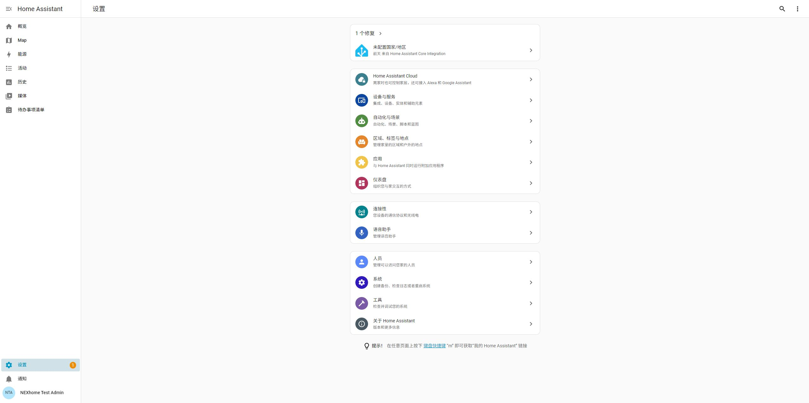

### 3. 准备好备份和网络

先保留自己的HA备份；HA和NexHome中控应在可通信的家庭网络。通常不用先查IP、IOTID或SN。多中控环境会要求选择，跨网络隔离不会被安装器偷偷修改。

## 二、Home Assistant OS：安装助手路线

### 1. 打开安装助手

在 **设置 → 应用/Apps** 中找到 **NexHome 滨融府友邻加强版**，安装、启动，再点“打开界面”。本轮内部包由维护者核验后放入本地来源；当前尚无面向住户的商店下载地址。

这条路线不需要先安装Terminal应用，也不需要在终端手工复制组件文件。

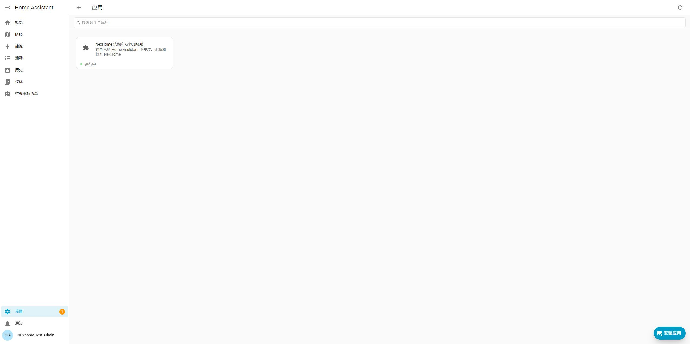

### 2. 开始检查

点“开始检查”，确认这台HA适合安装。如果提示来源不明或两种工具同时管理，请停止，保存脱敏诊断再咨询维护者，不要反复强装。

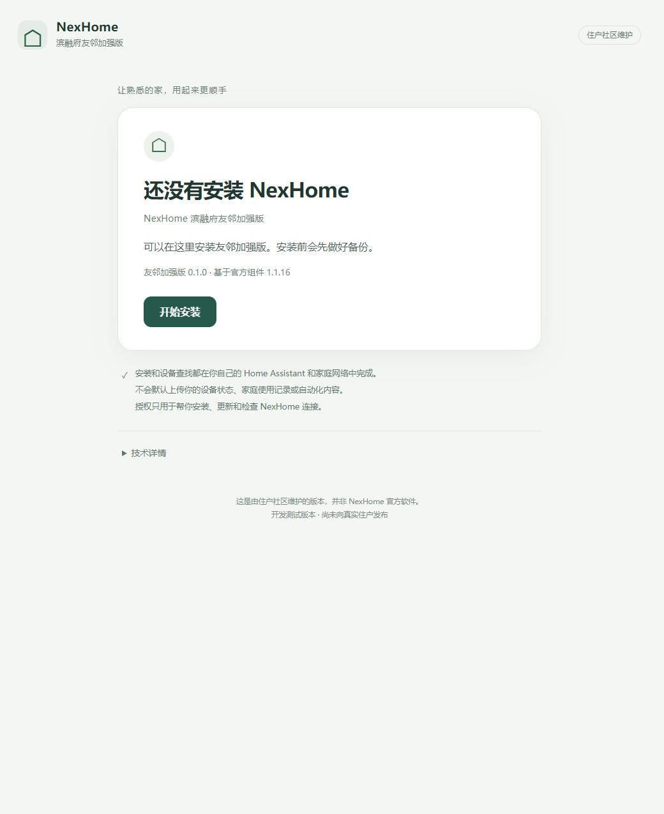

### 3. 确认安装

阅读备份及短暂重启提示，确认后开始。重启时页面断开属于可能发生的情况；若未自动回来，重新打开安装助手，不要再安装一次。

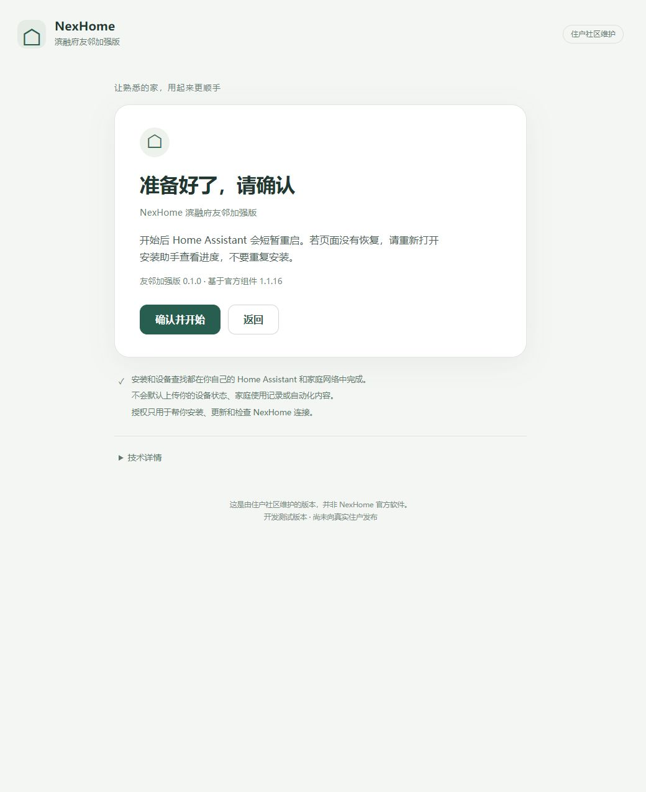

### 4. 部署后继续连接

看到“组件已部署，接下来连接中控”，点 **开始连接NexHome**。直接进入HA原生配置窗口，系统在这里查找中控；不用自己去菜单里翻找“添加集成”。如果HA要求再次登录（例如刚重启，或上次没有保持登录），使用自己的HA账号登录后继续连接；不要为此重新安装，也不用输入中控密码。

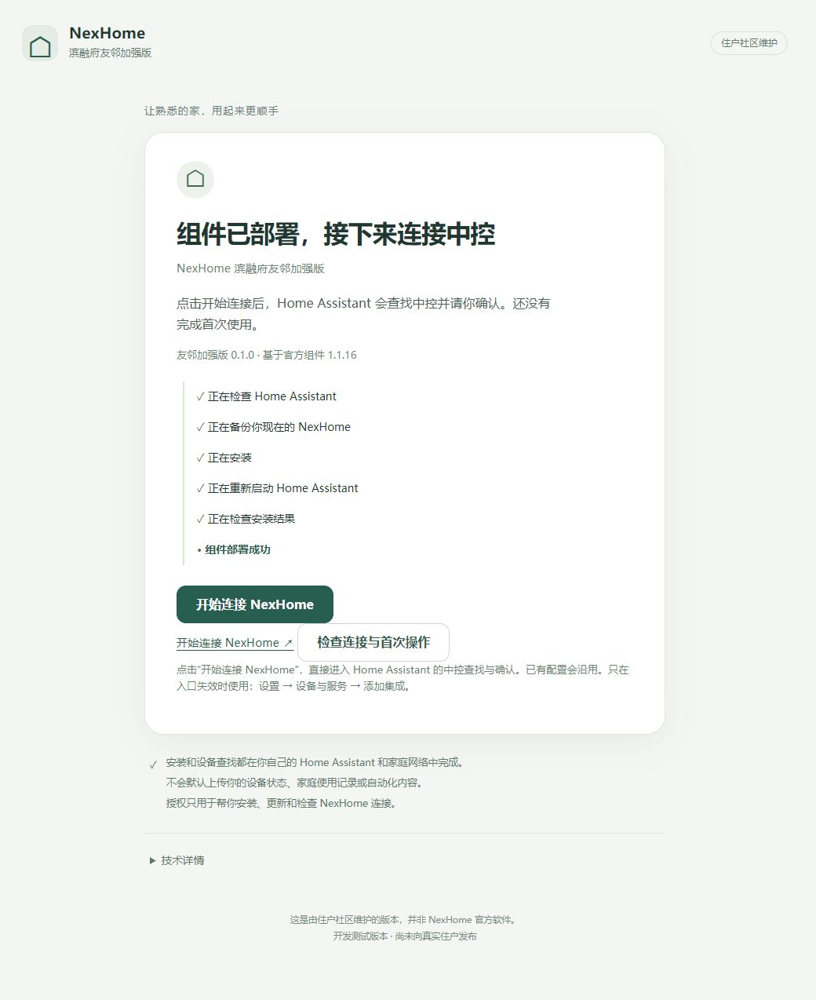

## 三、Container / NAS / Linux：一次性Terminal路线

这条路线需要管理HA容器的本地权限。Terminal就是输入命令的窗口，可以是NAS提供的终端或维护者已有的SSH终端。不要为了照教程改路由器、打开公网或把密码发给别人。

当前实际验证的是已有Linux Docker、可写配置目录、固定官方HA2026.10.2镜像。其他NAS封装、非Docker安装和主机Python版本不同，先请维护者确认，不要直接照搬命令。

### 1. 核验测试包

拿到维护者提供的**固定版本包及独立hash**后，先核对来源和SHA-256。包中的artifact记录产品0.1.0、上游1.1.16、固定commit和文件清单；安装器还会再次校验。不要把“和包放在一起的一个hash文件”当作来源可信的唯一证据。

### 2. 执行本地安装命令

以下是本轮核验过的命令形状，尖括号是需要由本机维护者替换的路径/容器名，**不是直接可运行的住户下载命令**。正式分发入口尚未发布；不要自行找第三方脚本代替。支持的Python执行环境须与当前测试的3.14兼容，不要为此升级生产主机Python。

```sh
cd '<已核验的固定安装包目录>'
python -m neighbor_launcher.bootstrap \
  --config '<HA在主机上的配置目录>' \
  --package '<已核验的固定安装包目录>' \
  --container '<你的HA容器名>' \
  --ha-url '<你自己的HA地址>'
```

第一次只检查和预览，不安装。核对结果后，用同一组参数加 `--confirm` 才部署。授权按屏幕提示在本地隐藏输入；它是HA访问授权，不是中控SN，也不要求发给维护者。维护者可使用本机专有、用后撤销删除的临时授权文件，不能把明文放在命令行。没有合适授权或运行环境时停止，由本机维护者处理。

程序会检查配置目录确实属于指定容器，先备份，再短暂重启**这一台HA**。不会创建新HA或重启Docker里的所有服务。**不要用不透明的curl管道脚本代替上述固定包。**

### 3. 打开程序给出的HA链接

终端显示“组件已部署”，并给出本机HA原生连接地址。打开该链接，后面的确认、查看设备和第一次操作与安装助手路线完全相同。完成一次操作后，维护者可用同一组参数加 `--verify-completion` 检查读回证据并确认已找到设备；这个检查不会发送设备命令。证据不全时不会显示安装完成。终端可以退出，它不是设备运行依赖。

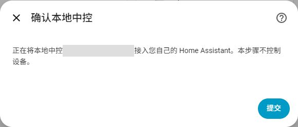

## 四、连接家里的NexHome

### 新安装

点击连接入口后，HA可能先问“您想要设置此集成吗？”，点“确定”进入。随后自动查找：只有一个中控时，核对后点“提交”；多个时先选择自己的中控，再确认。系统不会静默替您添加未知中控。完成后可以在“命名和分配”页面整理设备，或点“跳过并完成”稍后整理。

没有找到时，可以重试，确认HA与中控网络可达。只有直接入口无效时才用最后的备用路径：**设置 → 设备与服务 → 添加集成 → NexHome 滨融府友邻加强版**。高级手动参数只在确实需要时由维护者协助，不作为普通流程。


### 已经用过官方或旧版组件

**不要删除原来的NexHome。** 正常升级沿用原配置、名称、隐藏状态、房间和引用，不重新发现一个重复中控。如果原连接离线，应先检查原因，不要靠删除重建“解决”。HACS管理的安装会要求按正常HACS界面交接更新责任，保留HA里的条目。

## 五、第一次看到并控制设备

1. 打开 **设置 → 设备与服务 → NexHome 滨融府友邻加强版**。
2. 点设备数量或设备列表，找到“客厅主灯”等自己的设备。
3. 打开设备的控制项，先对一盏合适的灯开一次、关一次。看实际灯是否动作，并确认HA状态随后一致。
4. 回安装助手点“检查连接与首次操作”。真实状态已读回后，确认“我已找到设备并完成首次操作”，才显示安装与首次使用完成。

终端路线同样先按原生链接进入设备并完成第一次操作，不把终端退出码0当成所有设备已经可用。助手机器人不会为了点亮“完成”而自动开关家里设备。

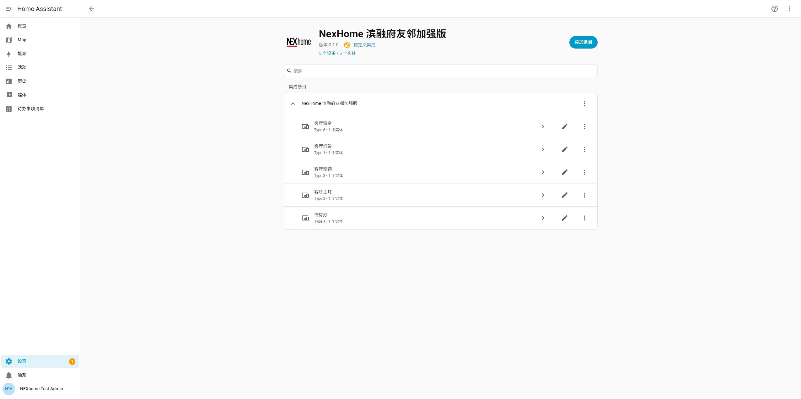
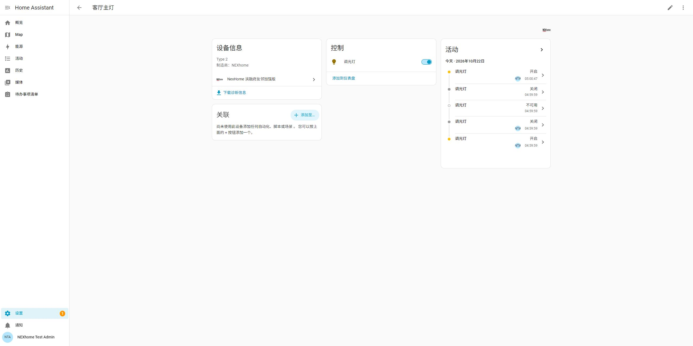
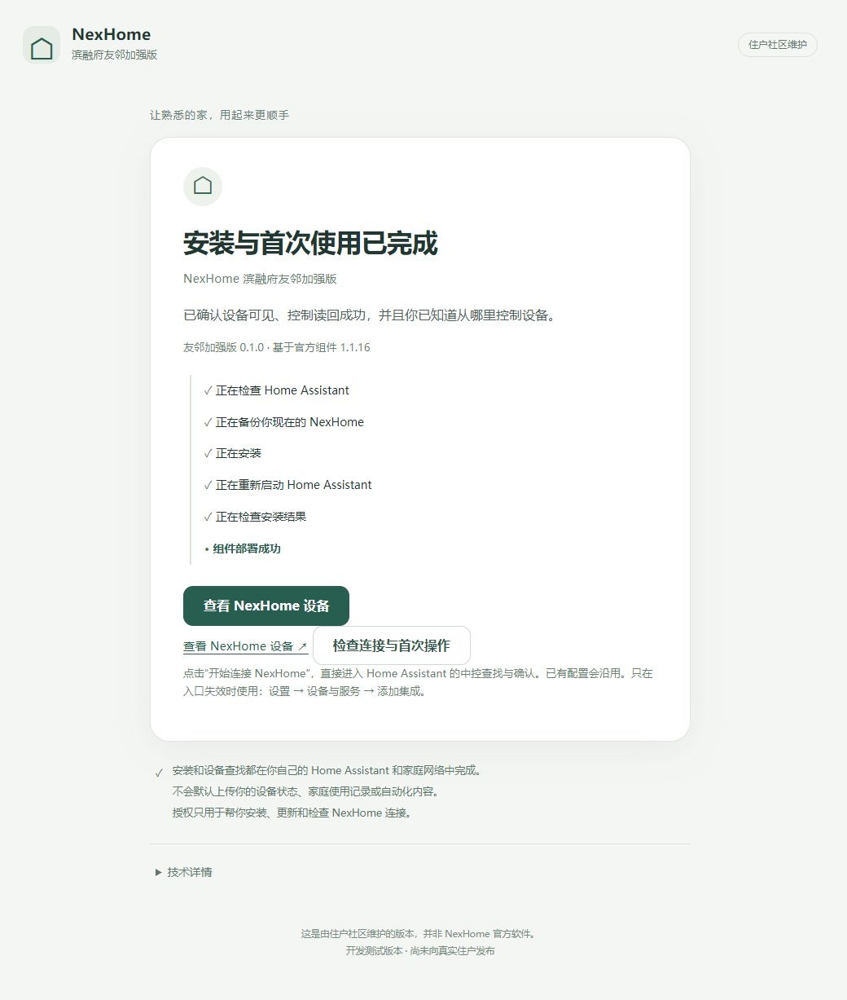

### 在自己的首页添加控制卡片

默认概览能自然显示部分设备；已有自定义页面不会被本项目改动。要自己整理时，先到 **设置 → 仪表盘 → 添加仪表盘 → 从新建仪表盘开始**，取名“NexHome”，按提示填页面地址并创建。

打开新页面，点编辑铅笔 → 添加卡片 → 按实体，搜索并选择一盏灯或窗帘，点击建议的“磁贴”卡片添加，最后点页面上方“完成”。已有可编辑页面可直接添加，不必重复新建。先放常用设备，不必一次整理全屋。

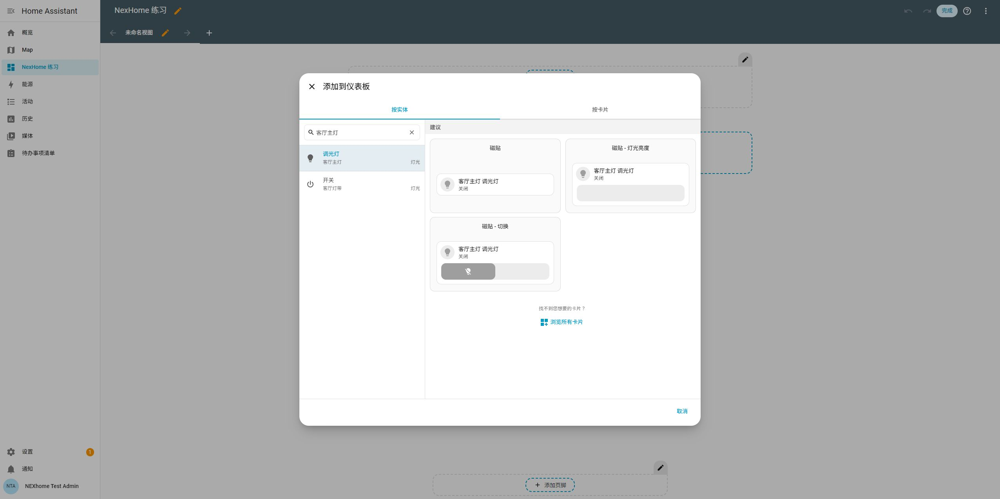

没有位置反馈的窗帘可能显示unknown/未知，仍可明确开/关/停；不要据此填一个假的百分比。

## 六、装好以后，推荐先做这5件事

### 1. 整理房间

到 **设置 → 区域、标签与地点 → 区域** 建立“客厅”“书房”等房间；再进入设备页选择所属房间。房间只是帮助找设备，不会改变线路。先整理两个常用房间即可。

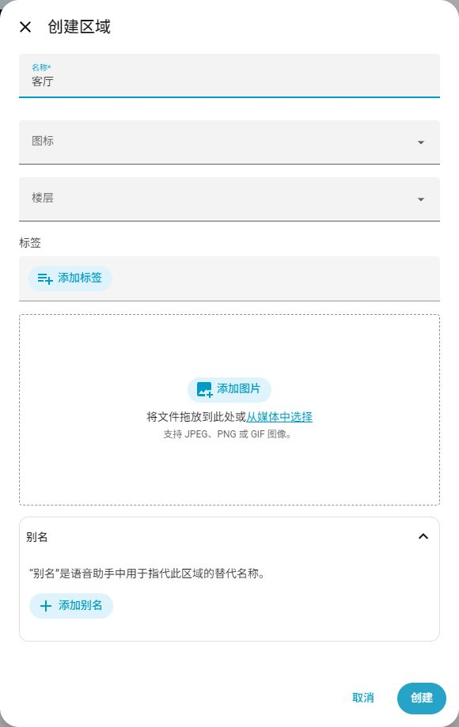

### 2. 建一个“客厅灯”设备组

打开 **设置 → 设备与服务 → 辅助元素 → 创建辅助元素 → 群组 → 灯组**。取名“客厅灯”，选择客厅主灯，用“添加实体”继续选择灯带、射灯，再点“提交”和“完成”。保持“所有实体”关闭，这样只要一盏亮着，灯组就显示开启。以后点一次控制整组；成员只选同一房间实际展示的灯，别把底层隐藏开关重复加进去。

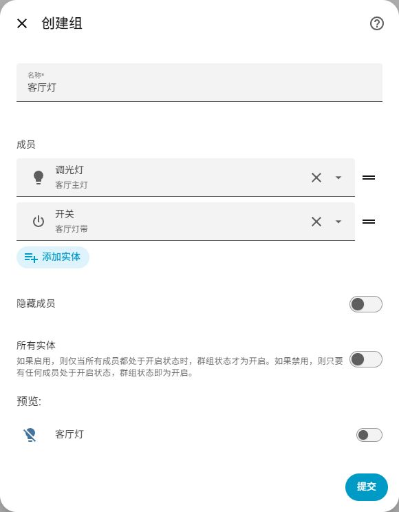

### 3. 建一个“观影模式”场景

打开 **设置 → 自动化与场景 → 场景 → 创建场景**。在“实时编辑”中添加客厅主灯、灯带、窗帘，再按想要的状态调好。添加后可切换“预览模式”查看细节；预览模式不能新增成员。最后点“保存”，命名“观影模式”。示例为主灯关闭、灯带打开、窗帘关闭。

场景是“一次把几台设备变成想要的样子”。点场景或一句语音就可触发。**在真实环境编辑场景时，界面操作可能立即影响选中的设备，先确认家人方便再试。**

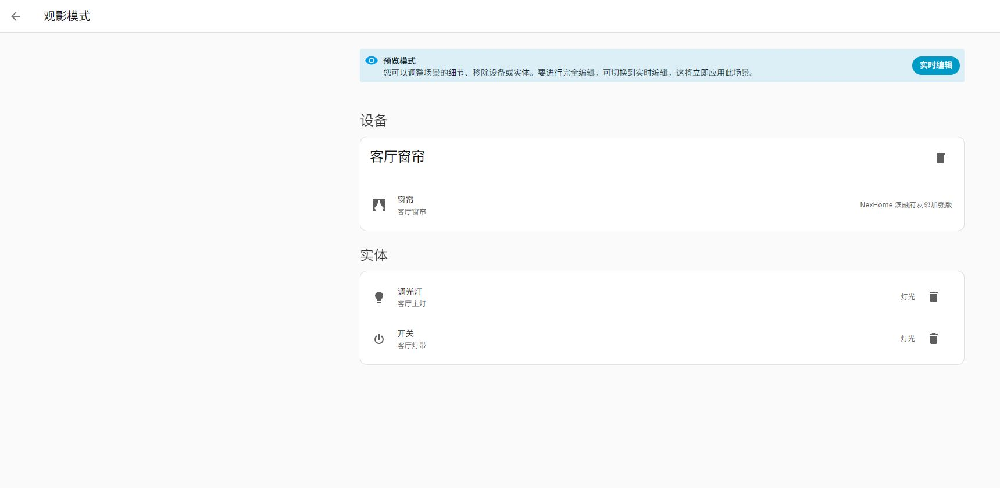

### 4. 建时间/日落自动化

自动化可以理解为三个部分：**何时发生 → 满足什么条件 → 做什么事**。从设置 → 自动化与场景 → 创建自动化 → 创建新的自动化开始，按下面例子逐项选择，不需要写代码。

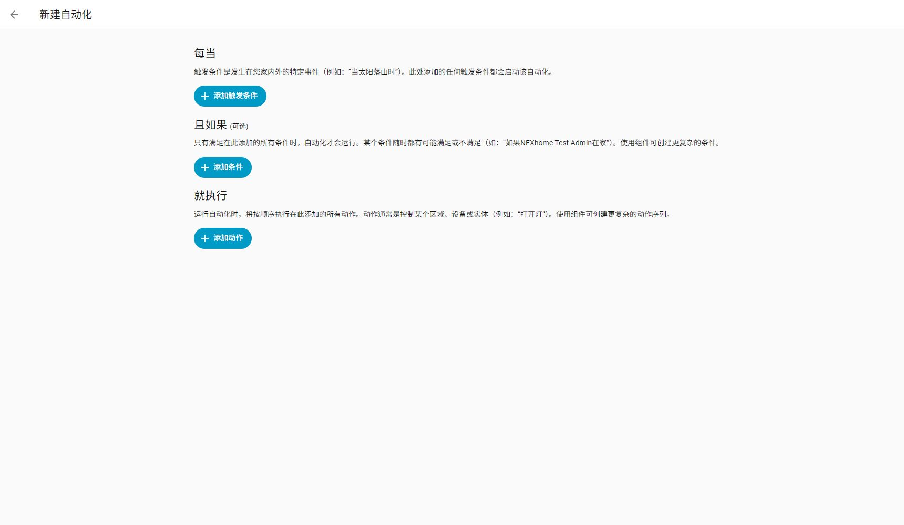

#### 示例1：每天早上07:00开指定窗帘

1. 添加触发条件，选择“时间”，再选“在特定时间或特定日期触发”的“时间”，填07:00。
2. 添加动作，选择“打开窗帘”，目标只选要开的那一组。
3. 保存为“早上开客厅窗帘”。第一次手动运行时在现场观察，确认没有选错。

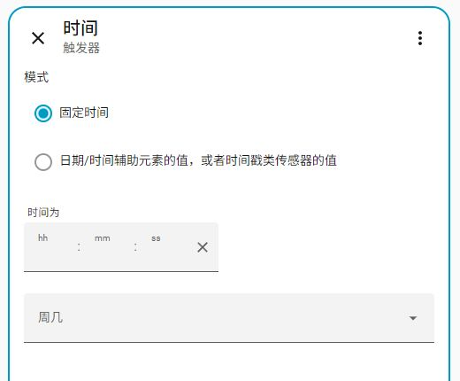

#### 示例2：工作日早晨开卫生间灯，再按时关闭

拆成两条最容易理解：

- “工作日早灯”：触发时间06:50；条件选择“时间”，只勾周一到周五；动作“打开灯”，选指定灯。
- “工作日关早灯”：触发时间07:30；同样的工作日条件；动作“关闭灯”，选同一盏灯。

保存前看清目标，不要选成整个房间的灯组。图中用通用测试灯示意，不在私密房间实测。

#### 示例3：每天太阳落山后关窗帘

1. 添加触发条件，选择“太阳”，再选“日落（日落时触发）”；不填固定18:00。
2. 添加动作“关闭窗帘”，选目标。
3. 保存为“日落关客厅窗帘”。

HA会按每天日落时间触发，因此需要“家”的大致位置正确；夏天、冬天的日落不同。[官方触发器说明](https://www.home-assistant.io/docs/automation/trigger/#sun-trigger)

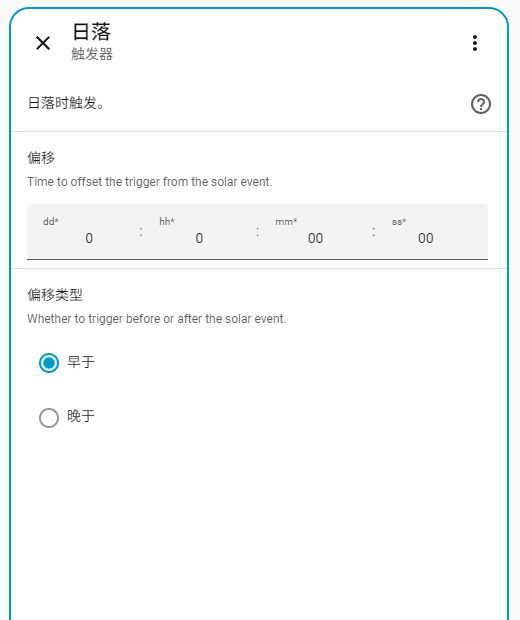

### 5. 开启手机定位，试回家/离家自动化

先按后面的“在手机上使用”登录，再按“家与定位”检查权限和家范围。先观察几天在家/离家显示是否可信，再允许自动关整屋灯。不是先写自动化再等定位“自然准确”。

## 七、在手机上使用

**iPhone和Android用户请安装官方Home Assistant App。**

安装后，登录自己的Home Assistant，就可以在手机上查看和控制已经接入的NexHome灯光、窗帘、空调等设备。后面的定位、到家/离家自动化和通知功能，也都通过Home Assistant App完成。

- iPhone：[官方App Store入口](https://apps.apple.com/app/home-assistant/id1099568401)，名称Home Assistant。
- Android：[官方Google Play入口](https://play.google.com/store/apps/details?id=io.homeassistant.companion.android)，名称Home Assistant。
- 也可从[官方移动端下载页](https://companion.home-assistant.io/download/)进入；无法访问对应商店时先查官方说明，不安装同名来历不明的软件。


第一次在家中Wi-Fi打开App，选择自己的HA；没找到时输入自己原来能打开的HA地址，使用自己的HA账号登录。登录后的控制页面就是自己的HA页面。

如果希望使用“到家自动开灯”“全家离家后自动关灯”，下一节会介绍必要的位置权限。这里先完成下载和登录即可。[官方首次登录说明](https://companion.home-assistant.io/docs/getting_started/)

## 八、家与定位：先观察，再自动化

### 设置“家”

打开 **设置 → 区域、标签与地点 → 地点**，编辑“家/Home”。把中心放在自己家的大致位置，范围可以先设约100米，再根据实际定位表现调整。不要把测试图中的示意位置照搬到家里。

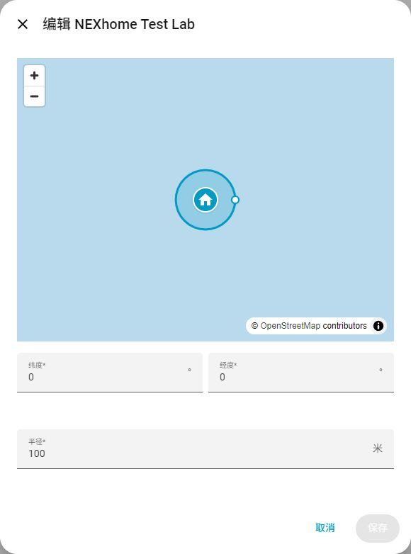

100米是示例范围，不是绝对精度。GPS、手机系统后台、节电设置和网络都会影响及时性；坐在家里却显示离家时，先检查定位和家庭区域，别急着执行自动关灯。

### 给手机必要权限

- iPhone：系统设置 → 隐私与安全性 → 定位服务 → Home Assistant；按系统提示允许后台所需的位置权限、精确位置。后台功能一般需要“始终”，界面可能先询问“使用期间”再询问“始终”。
- Android：Home Assistant的应用权限中允许需要的位置/后台定位，并检查应用里的位置追踪开关及节电限制；不同厂商菜单不同。
- 每位成员用自己的账号和手机；在HA“人员”里将对应手机关联给对应人员。只观察到一个手机，不能代表全家。

离家时，手机还需能把状态传回HA；远程访问未打通或VPN断开，位置更新可能延迟。[官方定位说明](https://companion.home-assistant.io/docs/core/location/)

### 示例4A：夜间回家开客厅灯

1. 触发器选“区域”，对象选自己的人员，区域“家”，事件“进入”。
2. 条件选“状态”，选择“太阳”，状态选“地平线以下”（表示夜间）。
3. 动作选“打开灯”，目标“客厅灯”。
4. 保存后先观察定位变化和自动化运行记录，确认没有反复误触发。

### 示例4B：所有家庭成员都离家后关灯

**多成员家庭不能只用“我的手机离家”就关闭全屋灯。**

1. 先确认每位常住成员都正确关联手机；有人没带手机、定位离线或未纳入名单时，不启用整屋关闭。
2. 触发器用“家区域人数变为0”，可加持续几分钟后再判断。
3. 条件再次核对每位成员明确处于离家；unknown/unavailable不能当作离家。
4. 动作只选核对过的灯组，先从客厅试起。客人或保洁可能仍在家时，加手动“暂停离家自动化”的开关，或保持手动控制。

单人家庭也先验证自己的定位可靠。人员/区域人数条件需要本户实际名单和权限；本轮只验证编辑界面与逻辑，没有以真实手机离家做现场验收。

## 九、通知

在手机允许Home Assistant通知权限后，自动化动作里选择对应手机的“发送通知”，先只给自己发一条“测试通知”。确认目标手机正确，再加到需要的自动化里。不要把设备故障告警误发给所有家庭成员。本文不替您创建通知或改变已有摄像头通知。

## 十、用语音控制家里的设备

### 原有家庭语音中控

友邻加强版只增强HA接入，不主动修改开发商NexHome Hub或原有语音系统，设计目标是原控制方式继续正常。**当前没有对应语音中控实机，待邻居真实环境验证，不能写成兼容已通过。**

未来获得单独试点授权后，检查表应记录安装前品牌/型号、可控设备、示例命令；安装后重复相同命令，逐项确认。本轮不启动Pilot。

### HA可以扩展的语音平台

| 方式 | 可以尝试的方向 | 本项目证据状态 |
|---|---|---|
| Home Assistant Assist | 使用HA支持的语音入口、语言和暴露设备 | NOT YET VERIFIED |
| Apple Home / Siri | 在HA配置对应桥接后控制暴露设备 | NOT YET VERIFIED |
| Google Assistant | 按HA官方支持路径连接 | NOT YET VERIFIED |
| Alexa | 按HA官方支持路径连接 | NOT YET VERIFIED |
| 原开发商语音中控 | 预期保持原功能 | NOT YET VERIFIED |

VERIFIED表示实际通过；NOT YET VERIFIED表示未验收；UNSUPPORTED只用于有明确不支持证据的型号/路径，不能拿未测当不支持。本轮没有语音路径达到实机VERIFIED。

例子：“打开客厅灯”“把客厅灯调暗一点”“关闭窗帘”“把空调调到24度”“启动观影模式”。一句话执行场景比只开一盏灯更方便；实际支持取决于语音平台、设备暴露和命名。[HA官方语音入口](https://www.home-assistant.io/voice_control/)

## 十一、出门以后还能用吗？

如果已经能在外面打开自己的HA，已接入设备仍从那里操作。如果只能在家Wi-Fi用，需要单独解决HA远程访问。

- 最省事：Home Assistant Cloud。
- 有NAS/服务器/域名：HTTPS及反向代理。
- VPN类：Tailscale、WireGuard或自己已有VPN。
- Tunnel类：Cloudflare Tunnel等，需要自行评估账户、认证和服务边界。

这里不展开网络部署教程。友邻加强版不自动改路由器、不自动开公网端口、不自动建立远程控制通道。远程访问方案和手机实机联动本轮未现场验证。[HA官方远程访问说明](https://www.home-assistant.io/docs/configuration/remote/)

## 十二、安全与遇到问题

先用灯、窗帘、普通场景练习。门锁、燃气、大功率电器和无人时运行的设备不作为新手自动化示例。多成员在家判断、手机定位误差、设备离线都应按“不确定”处理，不自动推断安全。

- 没找到中控：重试并检查家庭网络；不扫描全网、不擅改路由器。
- 已有条目不可用：保留原条目，先检查连接；不删除重建。
- 显示组件部署成功：继续连接和首次操作，不反复重装。
- 控制未确认：看设备真实状态，不靠一直点击重试；记录脱敏错误给维护者。
- 恢复未完成：停止操作，保留备份；不要认为换回代码一定能撤销所有设置变化。

不要发送密码、token、完整SN/IOTID、家庭成员或精确位置截图。手册图片只展示测试数据。自定义Dashboard、房间和自动化都由您自己决定是否修改。

## 本文验证边界

安装与原生流程、设备与模拟控制：见本轮验证报告；图源为HA2026.10.2隔离VM201/VM400或官方App网页。示例自动化只用于说明和测试环境编辑，不代表已在真实家庭执行。手机实机、原语音中控、所有语音平台、其他NAS、远程访问、多户长期运行尚未验收。

[回到项目首页](../README.md) · [技术验证记录](phase2-staged6.md)
